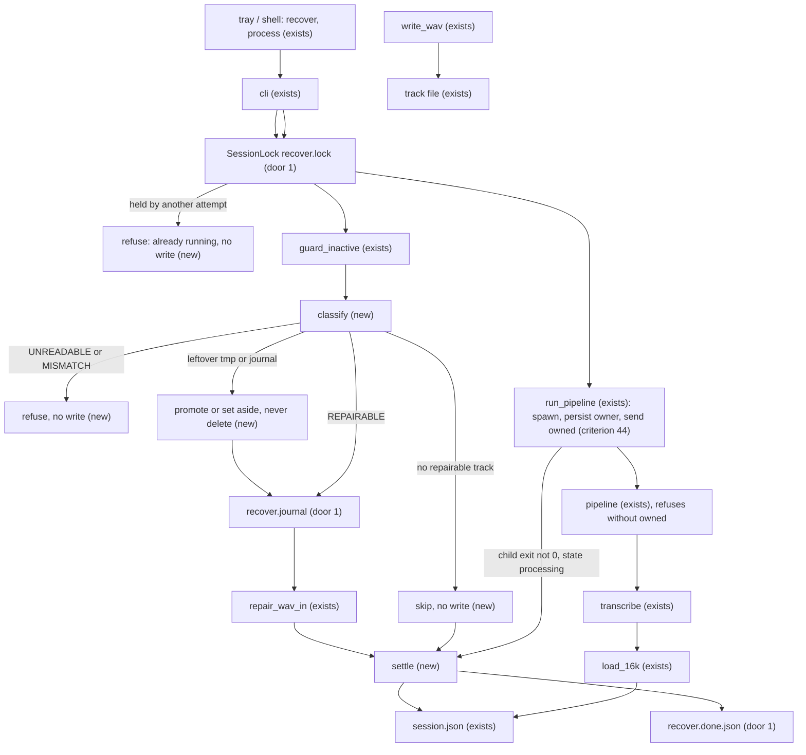
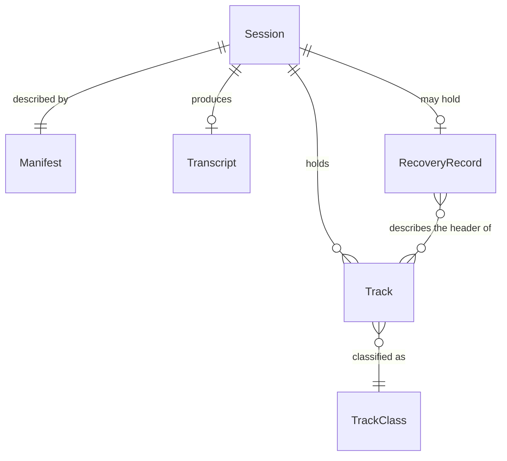
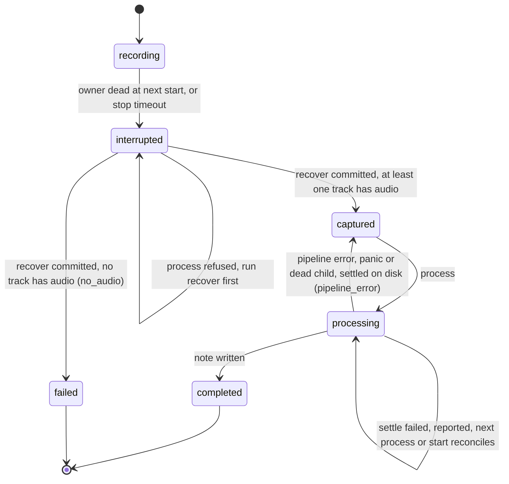
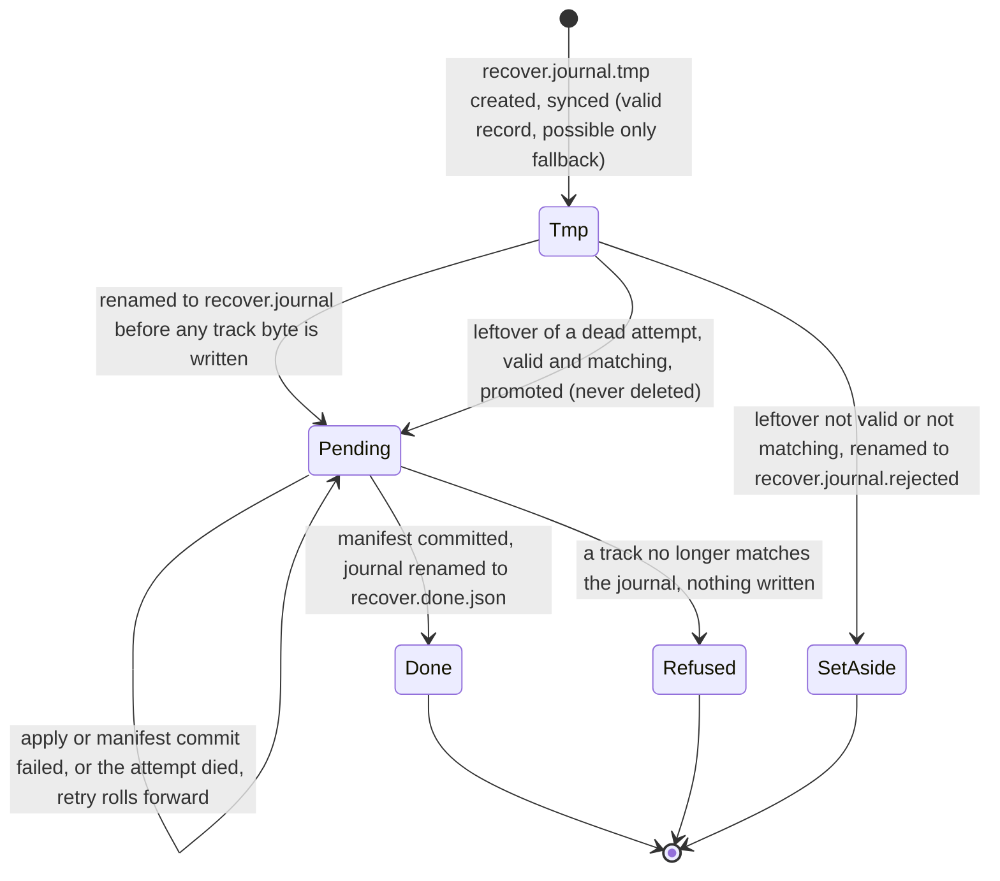

# M7: recovering an interrupted recording whose system track is empty or silent

**Approved**: 2026-11-09 - Sammy via Parker `c84400e5-4c36-4b69-bedb-efc97cebeb27` (relayed by Otto `188b6df6-ff7e-48ee-9372-d1d1e8296a9d`; approved source `plan-c18d6da1.md` SHA-256 `c18d6da17cce5fd4b71c60c1783ba7711bbb15ccf342bbbf24cf181f0e8d5064`) - user: "Aprovar c18d6da1 (Recomendado)"

Complexity: high. Flags: database (data-loss and backup trigger of engineering-roles.md; this revision proposes three small metadata files and one lock file, see Landing, but no schema change), security (untrusted WAV files and user recordings; the metadata files are a new input to review). Builder: Dani only, and only after the separate approvals listed under Delivery order. Felix is not the builder of this change.
Status: FINAL plan text. Basis: frozen `plan.r4b-3702a73b.md` (SHA-256 `3702a73b4bac037e53381a1da3fda7ae72353a09e324981d51aeb7f9c2ad7a59`, revision 4 with decision 4b, Dale PASS and Cyrus PASS on that hash). Earlier frozen revisions: `plan.r1-3cabeeef.md` (`3cabeeef65314d4efe8b32ddd68a9850a55c0669963fb857cb4403694bd18637`), `plan.r2-dcdb6763.md` (`dcdb67633ca6ccb52b44d407eb137c9d4d489040a4c71caee6c262bf702a4ce1`), `plan.r3-26ade558.md` (`26ade558a91b8982b2235a5ce842e5d5ca4f8e5d3d16d77fb4216fa4b6720876`), `plan.r4-e2bf06bc.md` (`e2bf06bc01315ca112db79a6a90731d25389abf6bdb8e72710757208cf433d1c`); all frozen, reviewer files untouched. Changes against `3702a73b` are text only and are listed in `closure-map.md`: the corrected b2 criterion of row 41(b), Sammy's decisions 1 to 6 materialized, the 8-byte bound of the child's input line, and the status and decision wording. All owner decisions are recorded with their source in `Shared/evidence/parker-m7-approval-20261109/approval.md` and in "Decisions"; none is open, and the Windows gate has a recorded status in "Feasibility inventory". Nothing is approved by this text: the `**Approved**` line stays pending until Sammy confirms the final hash in his own words. Plan only: no `checks.md`, no code, no test, no build, no run on this host.
Repository: `sammyjdev/voxis`. Source SHA for every recipe: `c2d7b6c6294c9fe67709cc6c2b1c1650fdff5de1` (tag `v0.2.0-rc4`, tip of `dev/windows-port-fixes`, read from a fresh clone on 2026-11-09). Future location `.specs/features/m7-silent-track-recovery/plan.md`.
Authorization: Sammy through Parker message `f6c470ec-f2b3-4df7-a4a7-2d648d6b5a94` (2026-11-09), "Pedir o plano do M7 ao Pietro"; dispatch Otto `6cdb04c0-6fdf-4aa2-9b61-1bf960be085c`; correction round Otto `4f71140c-d308-4c3a-bc20-666410d8b7a5`. Owner decisions and approvals (Sammy via Parker, 2026-11-09, recorded in `Shared/evidence/parker-m7-approval-20261109/approval.md`): decisions 1 to 6 and the 8-byte input bound accepted as recommended in Otto's `DECISION-PACKAGE.md`; 4b `Só falhas de processo (Recomendado pelo Dale)` (Parker `7c8af4e3-5fbb-4168-a225-596528471c63`); 7b not selected; the b2 correction `"Aprovar a correção do b2 (Recomendado)"` and `"Autorizar só o plano final (Recomendado)"` (Parker `779a592f-e8ef-4e9a-9c1f-f25cb51a957e`); plan of record before this text `3702a73b`. Scope exclusions held: M15 and the orb, latency and defaults, macOS and Linux, portable-core extraction, tag, build, release, merge, PR.

## Problem

A user who stops a recording by killing the recorder (a crash, Task Manager, a power cut) while the output device is silent cannot get the session back, and the product panics on the way. Vera's Preflight B on the installed rc4 candidate (`Shared/evidence/vera-voxis-pr5-6eee125-execution/preflight-b-rc4/run/m7_*`, session `20261108-210031`) observed, after the recorder was killed with a silent output device:

- `system.wav` was 0 bytes (SHA-256 `e3b0c442…b855`, the hash of the empty file).
- `meetrec recover` exited 1 with `system.wav is too short to repair`, yet it had already rewritten `mic.wav` (SHA-256 `6c550c96…403f` before, `fa7d8238…6e96` after) and left the session `interrupted` with `error.code` `owner_died`.
- `meetrec process` then exited 1 with `thread 'main' panicked at meetrec\src\main.rs:443:46: open wav: IoError(...)` and left the session in `processing` with a dead process id (`m7_states.txt`: `after process: state=processing`). The audible-loopback repeat (M7b) recovered and completed.

Source reading at `c2d7b6c` is consistent with that evidence (static, not reproduced by the planner):

- `writer` wraps the file in a `BufWriter` (`main.rs:318`) and hound writes the 68-byte header into it (hound 3.5.1 `write.rs:234-250`, 32-bit float mono uses the extensible header); WASAPI loopback delivers no chunks while nothing plays, so nothing reaches the file before a kill (hypothesis for the 0 bytes).
- `recover` loops `mic.wav` then `system.wav` and aborts on the first error with `?` (`session.rs:511-520`), after earlier tracks were already modified in place.
- `repair_wav` (`session.rs:468`) checks `len < 44`, but this recorder's header is 68 bytes; it never checks the RIFF/WAVE tags, reads the whole file into memory, writes `len - data_offset` without the guard `repair_wav_in` has (a 64 to 67 byte file underflows), and does not cut the data length to whole samples.
- `load_16k` (`main.rs:442-449`) uses `expect("open wav")` and `Result::unwrap`, so an empty, short or inconsistent file panics; `pipeline_failed` runs only on a returned `Err`, never on a panic (`session.rs:276-286`).

What is different for a user when this ships: an interrupted recording with an empty, header-less or silent system track recovers in one `recover` and completes in one `process` with the microphone transcript; nothing the user recorded is deleted, rewritten beyond two size fields per track, or lost to a panic; one `recover` at a time owns a session, a second one is refused and cannot disturb the first; a killed process, a panic or a failed write in the middle of the repair leaves a record from which the next `recover` finishes the job; the promise covers process failures only (Sammy's decision 4b, "Failure model"): after a power loss nothing about the automatic finish is promised, every sample stays on disk because no sample is ever written, and the two size fields of a track may need the manual repair that `INSTALL.md` describes; a session never stays `processing` after its pipeline died; a file that is not a recoverable recording is left untouched and named in the error.

## Base and landing

| Fact (read-only, fresh clone, `gh-planner` read token, 2026-11-09) | Value |
| --- | --- |
| `dev/windows-port-fixes` (PR #5, open, draft, base `spike/windows-rust-stt`) | `c2d7b6c6294c9fe67709cc6c2b1c1650fdff5de1` = tag `v0.2.0-rc4` |
| `spike/windows-rust-stt` (PR #4, open, draft, base `master`) | `889d48c9a2cca7f61a0648b832c3c3ac20953c78` = tag `v0.2.0-rc3` |
| `master` | `e2971bf21bfc579bf3cacb207cc97063ecd6fd7a` |
| PR #5 head against PR #4 head | 29 commits ahead, 0 behind (`889d48c` is the merge base) |
| The stale local control checkout | not an authority; not read |

The defect was observed on rc4 bytes (`c2d7b6c`), and only that lineage has the owner admission, `recover` guards and test seams this plan builds on; a base at `889d48c` would drop all of them and would not be what Vera tested. The base is therefore settled by the facts, not ambiguous. Landing (decision 1, selected by Sammy): a planned new branch `dev/m7-silent-track-recovery` from `c2d7b6c`, one pull request into `dev/windows-port-fixes` (stacked on PR #5), no push to the PR #4 or PR #5 head, no tag. The branch and the pull request are planned and are not created by this plan; creating them is a protected action that needs its own approval. rc3 and rc4 stay immutable; a patched candidate needs a new reviewed SHA and a new tag chosen by Sammy.

## Track classes and outcomes

Layout of the tracks this recorder writes (hound 3.5.1, 32-bit float, mono, extensible header, `write.rs:231-300` and `update_header` at `write.rs:488`): header length 68 bytes; RIFF size R at bytes 4..8, always `60 + D` once finalized; data tag at 60..64; data size D at 64..68; samples are 4 bytes each from byte 68. Fixed header fields (every recorder writes the same value): bytes 0..4 `RIFF`, 8..12 `WAVE`, 12..16 `fmt `, 16..20 = 40, 20..22 = 0xFFFE, 22..24 = 1, 32..34 = 4, 34..36 = 32, 36..38 = 22, 38..40 = 32, 44..60 = the IEEE-float subformat GUID, 60..64 `data`. Variable fields: R, the sample rate (24..28), the byte rate (28..32), the channel mask (40..44) and D.

Every class except EMPTY, FRAGMENT and UNREADABLE also requires L - 8 <= 4294967295, and a file above it is UNREADABLE.

Symbols: L = file length; P = L - 68 (payload bytes present, for L at least 68); W = P - (P mod 4) (bytes of whole samples present); D and R as declared. "Product header" means: L at least 68 and every fixed field above holds.

The classes are decided by bytes alone, never by audio level, and they are disjoint and exhaustive: a file belongs to the first row whose test holds, and the tests below are written so that no two rows hold at once.

| Class | Test | `recover` | Transcription step | Bytes after |
| --- | --- | --- | --- | --- |
| EMPTY | L = 0 (a kill before the first byte reached the file; a silent loopback delivers no chunk) | skipped, no write | skipped, no panic | identical |
| FRAGMENT | 1 <= L <= 67 and every fixed field that the L bytes cover holds (a prefix of a product header). The class says only that the bytes present agree with a product header; it does not prove the file was a recording | skipped, no write | skipped, no panic | identical |
| UNREADABLE | L >= 1 and not FRAGMENT, not HEADER-ONLY, not VALID, not REPAIRABLE and not MISMATCH: a short file that disagrees with the product header, a long file that is not a product header, or L - 8 above 4294967295 | the whole recovery is refused; nothing is written to any track; no record is created; `session.json` is unchanged | error naming the file | identical |
| HEADER-ONLY | product header and 68 <= L <= 71 (no whole sample), with any R and any D (a killed writer leaves R = 0 and D = 0; a finalized empty WAV has R = 60; a hostile header may declare D = 4294967295) | skipped, no write | skipped | identical |
| VALID | product header, L >= 72, W >= 4, D = W (R is not tested: hound ignores it, and `recover` never repairs R alone); 0 to 3 trailing bytes after the declared samples are allowed. A valid silent WAV is a VALID file whose samples are all 0.0, it is not a special class | no write | read like any other | identical |
| REPAIRABLE | product header, L >= 72, W >= 4, and either D = 0 (the killed-writer signature: hound writes the sizes only at finalize) or D > W (declares more samples than are present: a truncated file). `recover` sets D' = W and R' = 60 + W | writes only bytes 4..8 and 64..68, under the lock and the protocol of criteria 32 to 36 and 41 to 44 | read after repair; the file is VALID | only bytes 4..8 and 64..68 differ |
| MISMATCH | product header, L >= 72, W >= 4, 0 < D < W, or D > 0 with D not a multiple of 4 and D < W: the header declares fewer samples than are present and it is not the killed-writer signature, so neither keeping nor extending the declaration is known to be what the recorder meant | the whole recovery is refused (like UNREADABLE), nothing written | error naming the file and both numbers | identical |

Boundary table (the truth table that criterion 29 asserts; P = L - 68):

| L | D | R | Class |
| --- | --- | --- | --- |
| 0 | - | - | EMPTY |
| 1 .. 67 | - | - | FRAGMENT when the covered fixed fields hold, otherwise UNREADABLE |
| 68 | 0 | 0 | HEADER-ONLY |
| 68 | 0 | 60 | HEADER-ONLY |
| 68 | 4294967295 | any | HEADER-ONLY |
| 69 .. 71 | any | any | HEADER-ONLY |
| 72 | 0 | any | REPAIRABLE (W = 4, D' = 4) |
| 72 | 4 | 64 | VALID |
| 72 | 4 | 0 | VALID (R alone does not change the class) |
| 72 | 8 | any | REPAIRABLE (D > W, D' = 4) |
| 76 | 4 | any | MISMATCH (0 < D < W = 8) |
| 76 | 6 | any | MISMATCH |
| 73 .. 75 | 4 | any | VALID (1 to 3 trailing bytes) |
| 73 .. 75 | 0 | any | REPAIRABLE (D' = 4, the trailing bytes stay as they are) |
| 4294967304 | any | any | UNREADABLE (L - 8 above the largest u32) |
| 4294967303 | 0 | any | REPAIRABLE by the rules above (L - 8 = 4294967295 fits) |

Four distinctions the criteria hold: a 0-byte file (EMPTY) is not a valid silent WAV (VALID, whose samples happen to be 0.0); an interrupted or truncated WAV (REPAIRABLE) keeps every sample byte and gets only its two size fields set to what the file holds; a partial header (FRAGMENT) holds no audio and is never "repaired"; nothing outside REPAIRABLE is ever written, and the repair declares exactly the whole samples present (D' = W), so it never declares bytes that are not in the file and never leaves a whole sample undeclared.

## Shape

Reuses `repair_wav_in`, `update`, `guard_inactive`, `admit` and the `cli_with` and `Owners` test seams of `session.rs`, and `load_16k` and `write_wav` of `main.rs`; adds one exclusive session lock, one read-only classifier, one small recovery record and one error-propagating settle step. The rules that change an outcome run in pure functions the native suite reaches (`classify`, `repair_wav_in`, `load_16k`, `write_wav`, `cli_with`) and, for admission and crash windows, in `recover_session` over the `RecoverIo` seam of S0 (about ten named operations, not a storage framework); device, installed-app and recorder-kill behavior is proven in Vera's integration rows, not unit tests.

Source facts this revision relies on (read-only clone at `c2d7b6c`, not executed): `guard_inactive` (`session.rs:241-246`) checks only the recorder or pipeline owner named in `session.json` (`owner_of`, `:177-183`), never another `recover`; `admit` (`:197-209`) touches only sessions in `starting`, `recording`, `stopping` or `processing` and so never reads or writes a session in `interrupted`, `captured`, `failed` or `completed`; `process` does not write `processing` itself, the `miris.pipeline` child does (so the child, not `process`, owns the state while it runs); `update` and `write` (`:40-50`) are read, modify, write with a fixed `.session.json.tmp` and a rename that replaces.

1. user acts in the `tray` (exists) - "Recuperar gravação" on an `interrupted` session, or `meetrec recover <id>` from a shell; both reach `cli` (exists)
2. `SessionLock` (new, door 1) - `recover` takes `recover.lock` exclusively and without waiting before it reads anything, and holds it through the manifest commit and the done rename; `process` holds the same lock from before its owner check until its pipeline child returns, and hands ownership to the child before the child may act (step 8); a second taker is refused by name and changes no session file; the operating system releases a dead holder's lock, so "stale" means "the lock can be taken" and no process id is trusted; then `guard_inactive` (exists) checks the owner
3. `classify` (new) - reads at most 4096 bytes of each track, returns exactly one class of the truth table and writes nothing; a track that is UNREADABLE or MISMATCH refuses the whole recovery before any write, and each track to be repaired is opened for writing once as a readiness check
4. `recover.journal` (door 1) - one small file persisted (temporary file, flush, sync, rename) before the first track byte is written; it holds the session state before the recovery, and for each repairable track its length, its original 68 header bytes and the intended values, never a sample; a temporary file left by a dead attempt is never deleted: a valid one that matches the tracks is promoted, any other is set aside (criterion 42)
5. `repair_wav_in` (exists) - rewrites only bytes 4..8 and 64..68 of each repairable track, syncs the file and re-reads it as VALID; a failure leaves the journal pending
6. `settle` (new) - commits `session.json` through the existing temporary file and rename, returning any error to the caller, and only while the session is still in the state the recovery started from (criterion 43); `recover` renames the journal to `recover.done.json` only after the commit succeeded
7. `session.json` (exists) - state `captured` with error null, or `failed` with `no_audio`, or unchanged when the recovery is refused or any step before the commit failed (two named exceptions: the done rename failing after the commit, criterion 35, and a state that moved on, criterion 43, leave the committed or newer state in place)
8. `run_pipeline` (exists) - `process <id>` spawns `miris.pipeline` with its standard input piped and its command line unchanged; the child waits for one line `owned`, the caller first persists `processing` and the child's pid through `settle` and only then sends it, and the child checks that `session.json` names it before it does anything (criterion 44), so the exclusion survives the caller's death and the child never opens the lock; when the child exits non-zero while the manifest still says `processing`, it settles the manifest to `captured` with `pipeline_error` through `settle`, and reports a failed settle instead of claiming one
9. `pipeline` (exists) - runs `transcribe` (exists), which reads each track through `load_16k` (exists): no-audio tracks are skipped, unreadable ones return an error, nothing panics
10. `write_wav` (exists) - flushes the 68-byte header to the file when a track is opened, so a kill before the first sample leaves HEADER-ONLY, not EMPTY
11. out: `transcript.md` with the lines of every track that had audio, `session.json` in a state that is on disk, and every sample byte identical to what the recorder wrote

**Changes underneath**

| Front | What changes |
| --- | --- |
| domain | `recover succeeded` meant "every existing track passed `repair_wav` and the manifest was updated, errors of the update aside"; it now means "every track is classified, repairs applied only to REPAIRABLE tracks under the journal protocol, and the manifest commit succeeded"; the tray's "Processar gravação" row branches on the resulting `captured` state |
| domain | `a session in processing` meant "a pipeline is running or died unnoticed until the next `start`"; after this plan `process` settles it itself when its child exits non-zero |
| domain | `settled` meant "`fail` was called" (it ignores write errors at `session.rs:53-57`); on the paths this plan changes it means "`session.json` on disk says so" |
| stored data | `session.json` schema 1 keeps every field and state name; the only new value is `error.code` `no_audio` (door 1 of the approved Windows plan allows new codes); existing sessions need no migration |
| stored data | recordings: EMPTY, FRAGMENT, HEADER-ONLY and VALID tracks are never opened for writing; REPAIRABLE tracks change two u32 fields (8 bytes) and no sample byte |
| stored data | new metadata in the session folder (door 1): `recover.lock` (0 bytes, the exclusive session lock, created on first use and kept), `recover.journal` while a recovery is pending, `recover.done.json` after it committed, `recover.journal.tmp` while a record is being published, `recover.journal.rejected` only when a leftover record could not be used; plus the existing `.session.json.tmp`; nothing else is created and the product deletes none of these files and nothing recorded |
| domain | `recover` was "one process runs it, nothing stops a second"; it now means "one attempt owns the session from the lock to the done rename; a competing `recover`, and `process`, are refused by name" |
| readers | tray polling reads `captured`, `failed`, `interrupted` as today; `process` and `recover` callers read exit `0` or `1` and printed text; Python MIRIS ignores the new files and is untouched |

New: `RecoveryRecord` (the journal, door 1) and its link to the tracks it describes; `TrackClass` stays derived from bytes on each read and is never stored. One-way constraints: the journal's file names and field names (door 1).

## Surface

None - no route or command is added. The contract the tray consumes (exit `0` or `1`, last stdout line `note: <path>`, `session.json` schema 1, stdout and stderr as human text) keeps its shape; the new exit conditions and printed lines are criteria 1 to 13, 16 to 19 and 29 to 44. One behavior that callers can observe changes: a `process` or `recover` that overlaps another `process` or `recover` of the same session now exits `1` with a named message instead of running (criterion 41). The tray's `recover` and `process` callers are not edited.

## Landing

| One-way door | Literal shape | Alternative rejected |
| --- | --- | --- |
| recovery record, `recover.journal`, `recover.done.json`, `recover.journal.tmp` and `recover.journal.rejected` in the session folder (door 1) | one UTF-8 JSON object of at most 2048 bytes: `{"schema":1,"session":"<id>","prior_state":"<state of session.json when the recovery started>","tracks":[{"file":"mic.wav","length":<L>,"header":"<136 lowercase hex characters, the original bytes 0..68>","riff_size":<R'>,"data_size":<D'>}]}` with `file` only `mic.wav` or `system.wav`, one entry per repairable track (at most 2) and `prior_state` one of the state names of `session.json`; written as `recover.journal.tmp`, flushed, synced and renamed to `recover.journal`; renamed to `recover.done.json` after the manifest commit; never holds a sample. All four names are created, renamed and read by the product and deleted by nobody: a valid `recover.journal.tmp` left by a dead attempt is promoted, an unusable one is renamed to `recover.journal.rejected` (criterion 42), because the tmp can be the only copy of the original headers | a full copy of each track - doubles a recording that can be hours long and needs the space that a failing disk may not have; printing the old values only - lost with the console, not a restore record; extra fields in `session.json` - its schema 1 is read by the tray and Python MIRIS and it is the commit step of this protocol, so it cannot also be the record that precedes it; a sidecar per track - two files cannot be made atomic together; deleting a stale `recover.journal.tmp` - it may be the only surviving copy of the original headers after a lost rename |
| session lock, `recover.lock` in the session folder (door 1) | a 0-byte file opened for writing with share mode none (Windows `OpenOptionsExt::share_mode(0)`) and held by the open handle for the whole recovery or the whole `process`; created on first use, kept, never deleted, its content never read | a lock file created with `create_new` and removed at the end - after a crash it is stale and needs a liveness test; the process id in a file - pid reuse, and the check-then-act window between reading it and acting on it; waiting or retrying - an unbounded wait on a hung holder; a lock directory or a registry key - more state to leave behind. The operating system closes the handle of a dead process, which is the whole stale-owner rule |
| `error.code` value `no_audio` | string `no_audio` in `session.json` `error.code` with state `failed` | reusing `pipeline_error` - it means a provider or pipeline failure that `process` can retry, and nothing here can be retried |

- The handoff of criterion 44 is not a door: the line `owned` goes over a pipe between two processes of the same `meetrec` binary, is never stored, and the child's command line stays `miris.pipeline <dir>`, which `is_owner` and the tray (`apps/tray/src-tauri/src/miris.rs:193`, a liveness match only) read. The one visible change is that running the internal `miris.pipeline` marker by hand now exits `1` with `pipeline not started by process: no ownership handed over`.
- Nothing else in this change is hard to reverse: classes are derived on each read and messages are text. The retained artifacts are `recover.done.json` (decision 4: retain, or delete after commit) and `recover.lock` (0 bytes, kept because deleting a lock file while another attempt may be opening it is itself a race).

## Failure model

What the repair promises, by what goes wrong. Samples are never written by this protocol in any row. Decision 4b is decided by Sammy ("Só falhas de processo (Recomendado pelo Dale)", approval card of 2026-11-09 relayed by Parker `7c8af4e3-5fbb-4168-a225-596528471c63`): the promise covers process failures only. Today's `recover` has no record, no lock and no crash safety, so none of this narrows what ships; it is the owner-chosen scope of the new protection. No hardware or storage guarantee is claimed, and persistent I/O failures stay honest errors that leave the record pending for a retry (criteria 33, 36).

| What goes wrong | What survives | Automatic finish | Basis |
| --- | --- | --- | --- |
| a second `recover` or a `process` starts while one runs | everything; the second is refused | yes, the first continues | the exclusive lock (criterion 41) while the caller lives, and for `process` the ownership handoff of criterion 44 after the caller dies; planned proof in the modeled schedules (none run), the Windows sharing and handoff behavior unverified on this host (row 41b) |
| `recover` dies at any point (kill, panic, I/O error, Task Manager) | samples; the record (or its synced temporary file) with the original headers; tracks each at original or intended bytes, a field possibly torn | yes, the next `recover` rolls forward | write order and criteria 32 to 36 and 42; planned proof in the modeled fault recipes (none run) |
| power loss or OS crash (while `recover` is repairing, or at any other time), whatever the storage does | samples: the protocol never writes one; the track headers and the record are whatever the disk kept: a `data_size` that is a positive value below the samples present is class MISMATCH and is refused, and a later `recover` that finds a half-repaired but classifiable header records that header as "original" | not promised (owner decision 4b): the repaired values are always recomputable from the file length (`D = 4 * floor((L - 68) / 4)`, `R = 60 + D`, offsets 64..68 and 4..8), so the person fixes the two fields by hand with the steps of `INSTALL.md`, and the original bytes of a track can be lost | owner-chosen narrowing; no recipe models it and no experiment is run |

No fallback copy is ever disposable: a `recover.journal.tmp` may be the only copy of the original headers, so the product never deletes it (criterion 42). A power-loss guarantee (a directory flush, a volume flush or write-through renames) needs platform calls outside the standard library, an administrator handle or a new storage layer; Sammy chose not to ask for one and this plan does not propose or claim it. The synced temporary file, the journal, the retention and the promote or set-aside rule stay because they protect the original headers against a killed process and a partial write, not only against a power loss.

## Criteria

Section tags: S1 recover, S2 process, S3 recorder, S4 invariants and privacy, S5 verification, S6 exclusive admission, crash-safe repair and honest settlement (criteria 29 to 44). Items marked (selected) were recommendations that Sammy selected as recorded in `Shared/evidence/parker-m7-approval-20261109/approval.md`; they are requirements, not options. The reproducible pre-change failure recipe of every criterion is in "Pre-change failure recipes"; no recipe has been run. Classes are the rows of "Track classes and outcomes"; "repairable track" means class REPAIRABLE.

### S1: recover brings back a session whose system track is empty, partial or silent (P1)

The M7 case recovers in one command and the microphone track is kept.

**Acceptance Criteria**

1. WHEN `recover <id>` runs on a session with no live owner whose `mic.wav` is REPAIRABLE and whose `system.wav` is EMPTY THEN it SHALL fix only the size fields of `mic.wav` under criteria 32 to 35, leave `system.wav` at 0 bytes with SHA-256 `e3b0c44298fc1c149afbf4c8996fb92427ae41e4649b934ca495991b7852b855`, set state `captured` with `error` null, print `system.wav: empty (0 bytes), no audio captured, skipped` and exit `0`
   - `mic.wav` of 1000 samples with zeroed sizes plus an empty `system.wav` → `mic.wav` reads 1000 samples with sample bytes identical, state `captured`, exit 0; `system.wav` still 0 bytes
2. WHEN a track is FRAGMENT THEN `recover` SHALL treat it as in criterion 1, print `<file>: partial header (<n> bytes), no audio captured, skipped`, and leave it byte-identical
   - the first 1, 43, 44, 63 and 67 bytes of a product header → skipped; 30 bytes of text that do not agree with the fixed fields → UNREADABLE, criterion 9; exactly 68 bytes → HEADER-ONLY, criterion 3
3. WHEN a track is HEADER-ONLY (68 to 71 bytes) THEN `recover` SHALL print `<file>: no samples, skipped` and write nothing to it
   - 68 bytes with RIFF size 0 (killed), 68 bytes with RIFF size 60 (finalized), 68 bytes declaring 4294967295 samples, 70 bytes → all byte-identical after `recover`
4. WHEN both tracks are REPAIRABLE THEN `recover` SHALL fix both under criteria 32 to 35 and set state `captured` (existing result kept)
5. WHEN a track is VALID, including a finalized WAV of 48000 samples that are all 0.0, or a VALID file whose RIFF size is wrong THEN `recover` SHALL write nothing to it and SHALL NOT report it as empty
   - the all-zero WAV, a WAV of 1000 audible samples and a WAV of 400 samples whose RIFF size field is 0 → all byte-identical after `recover`
6. WHEN a track is REPAIRABLE because its declared data length exceeds the whole samples present (D > W) THEN `recover` SHALL set D' = W and R' = 60 + W, touch no sample byte, and the file SHALL read W / 4 samples with hound
   - declares 1000 samples, 400 present → reads 400 samples; declares 1000, none present (68 bytes) → HEADER-ONLY, no write
7. WHEN a track has 1 to 3 bytes after its last whole sample THEN `recover` SHALL leave those bytes unchanged: with D = W the track is VALID and nothing is written; with D = 0 the track is REPAIRABLE, D' = W, and after the repair it is VALID
   - 250 samples declared and 2 trailing bytes → identical; 250 samples with D = 0 and 2 trailing bytes → D' = 1000, length unchanged, 250 samples read, trailing 2 bytes unchanged, and a second `recover` writes nothing
8. WHEN `recover` writes to a track file THEN that track SHALL be REPAIRABLE and only bytes 4..8 and 64..68 SHALL change; every other class SHALL stay byte-identical, in particular a file that is not a product header even when the ASCII bytes `data` appear in it
   - 100 bytes of text with `data` at offset 40 → identical after `recover`, exit 1 (UNREADABLE); EMPTY, FRAGMENT, HEADER-ONLY, VALID → identical
9. IF any track is UNREADABLE or MISMATCH THEN `recover` SHALL exit `1` naming the file and the reason (`unreadable (<reason>)`, or `declared <D> bytes but <W> bytes of samples are present`), SHALL write no byte to any track (the other track included), SHALL create no recovery record, and SHALL leave `session.json` unchanged
   - `mic.wav` REPAIRABLE plus an UNREADABLE `system.wav` → both files byte-identical, no `recover.journal*` file, state still `interrupted`, exit 1 (the M7 trace repaired `mic.wav` first and then failed)
10. IF a track's length minus 8 exceeds 4294967295 (the largest u32) THEN `recover` and `repair_wav_in` SHALL classify it UNREADABLE (`larger than a WAV header can describe`) and write nothing, so no size field is ever truncated to 32 bits
    - length 4294967303 → classified by the normal rules; length 4294967304 → refused, no write
11. WHEN `recover` classifies a track THEN it SHALL read at most 4096 bytes of that file and SHALL NOT load a whole track into memory
12. WHEN `recover` fixes the size fields of a track THEN it SHALL print `<file>: riff_size <old> -> <new>, data_size <old> -> <new>` (decimal u32 values); the printed values are information for the person at the console and are not the restore record, which is criterion 32
13. IF no track holds audio (every track EMPTY, FRAGMENT or HEADER-ONLY) THEN `recover` SHALL exit `0`, set state `failed` with `error.code` `no_audio` and message `no track holds audio; the files were kept`, and leave every file byte-identical (selected, decision 3)
    - both tracks 0 bytes → `failed`, `no_audio`; mic HEADER-ONLY plus system EMPTY → same; mic with 1 sample plus system EMPTY → `captured`

### S2: process finishes or fails cleanly (P1)

**Acceptance Criteria**

14. WHEN transcription reads a track that is EMPTY, FRAGMENT or HEADER-ONLY THEN it SHALL print `<file>: no audio, skipped`, not panic, and transcribe the other track
    - 0 bytes, 1 byte, 67 bytes → skipped; 68 bytes → skipped; a VALID WAV under 1 s keeps today's `under 1 s of audio, skipped`
15. IF a track cannot be read (not a WAV, another sample format it does not support, a read error before the declared samples end, or an odd data length) THEN transcription SHALL return an error that names the file and SHALL NOT panic, and the pipeline SHALL end the session in `captured` with `error.code` `pipeline_error`, every file byte-identical, exit `1`
    - a track declaring 1000 samples with 400 present, read without a prior `recover` → error naming it, no panic
16. IF `miris.pipeline` ends with a non-zero exit status, by panic or any other cause, while `session.json` still says `processing` THEN `process` SHALL set state `captured` with `error.code` `pipeline_error` and a message naming the exit status, keep every file, and exit `1`; a failure to persist that state is criterion 37
    - the M7 trace left `processing` with a dead pid; a child that already wrote `captured` with `provider_timeout` keeps that code
17. WHEN `process <id>` targets a session in state `interrupted` THEN it SHALL exit `1` with `session <id> is interrupted; run recover first` and change nothing (selected, decision 3); independently of that selection `process` SHALL also refuse with `session <id> has a recovery pending; run recover first` and change nothing when the state is `interrupted` and `recover.journal` or `recover.journal.tmp` exists, so that the pipeline never reads tracks a pending recovery may still write; in any other state a leftover record does not stop `process` (the done rename may have failed after the commit, criterion 35)
18. WHEN a session whose system track is EMPTY and whose microphone track holds audio is recovered and processed with no Anthropic key THEN `process` SHALL complete: `transcript.md` holds only lines attributed to `Você`, no line attributed to `Outros`, state `completed`, exit `0`
19. The error text of criteria 9, 10 and 15, every printed line of criteria 1 to 3, 12 and 14, and every message of criteria 32 to 37 and 41 to 44 (the refusals and warnings of the lock, the record, the leftover files and the manifest, including the error strings they quote) SHALL contain only file names, byte counts, offsets, class names, state names, the session id, the numeric size values and operating-system error text, and SHALL NOT contain any byte of audio, any header hex of the record, any transcript text or any path other than the session folder
    - the captured stdout and stderr of every row of criteria 9, 10, 15, 32 to 37 and 41 to 44, searched for the fixture's sample bytes, the journal's `header` hex string and any transcript text → none found

### S3: the recorder stops leaving a 0-byte track (P2, selected)

**Acceptance Criteria**

20. WHEN the recorder opens a track file THEN the 68-byte header SHALL be written through to the file before the first sample chunk is received, so a recorder killed with no sample leaves a HEADER-ONLY file of 68 bytes (selected, decision 3)
    - a writer that receives no chunk for 2 s → the underlying writer already holds 68 bytes with the data tag at 60..64

### S4: nothing is lost (P1)

**Acceptance Criteria**

21. The system SHALL NOT delete, rename, truncate or replace any recording or note in a session folder during `recover`, `process` or the owner reconciliation of `start`, and the only files these commands create, modify, rename or delete SHALL be: for `recover`, the two size fields of a REPAIRABLE track, `session.json`, `.session.json.tmp`, `recover.lock`, `recover.journal.tmp`, `recover.journal`, `recover.done.json` and `recover.journal.rejected`; for `process`, `transcript.md`, `ata.md`, `minutes.json`, `note.path`, the `.url` shortcut, `session.json`, `.session.json.tmp` and `recover.lock`; and the product SHALL NOT delete `recover.lock`, `recover.journal.tmp`, `recover.journal`, `recover.done.json` or `recover.journal.rejected`, nor replace one of them with another file, in any command
    - the byte map of the folder before and after, minus those names and minus those 8 bytes → identical; a leftover `.session.json.tmp` from an earlier failure is overwritten by the next run and is never read as data; a leftover `recover.journal.tmp` is never overwritten, never deleted and is read only as a candidate record under criterion 42
22. WHEN `recover` runs a second time on the same session THEN it SHALL exit `0` and change no byte of any track, and SHALL NOT rewrite `recover.done.json` (idempotent)
23. WHERE the owner of a session is live THEN `recover` and `process` SHALL keep refusing with `session is active: <dir>` and change nothing (existing behavior kept); the one difference is order and is criterion 41: when the lock is held by a running `recover` or `process`, that refusal comes first and carries the message of criterion 41; a refused attempt changes no existing file and creates at most the 0-byte `recover.lock`

### S5: verification and immutability (P1)

**Acceptance Criteria**

24. WHEN the implementation is verified THEN the verifier SHALL find tag `v0.2.0-rc3` at `889d48c9a2cca7f61a0648b832c3c3ac20953c78` and tag `v0.2.0-rc4` at `c2d7b6c6294c9fe67709cc6c2b1c1650fdff5de1` unchanged, with their draft assets unchanged, reading with an identity that can see drafts (`gh-dev`; the default identity returns 404 for a draft)
25. The system SHALL keep the native suite (124 passed at `c2d7b6c`, as reported by Vera in Engineering seq 595 and not re-run by the planner) and the tray suite green, change no file under `apps/tray`, `packages/`, any workflow or any packaging file, and change no behavior of dictation, the overlay, `minutes`, or `models`
26. WHEN a criterion in S1, S2, S4 or S6 protects a recording from loss, overwrite or an unrecoverable session THEN its test SHALL be committed and shown failing at the source SHA (or at the behavior-neutral seam commit named in its recipe) before the production line that fixes it, and shown passing after it; the failing set measured by that run SHALL be recorded and SHALL be the evidence, the predicted outcomes in the recipe table SHALL NOT be quoted as results, and a red that was not kept before the edit is not accepted afterwards
27. WHEN the fix is built THEN Rita SHALL review the diff independently and Vera SHALL execute the frozen recipes and the integration rows on the built bytes; Dani SHALL NOT review or verify the change
28. IF the change alters shipped executable bytes THEN a patched candidate SHALL be a new tag chosen by Sammy on a new reviewed SHA built by CI into a draft release, and the rc4 evidence SHALL be reported as valid for the rc4 bytes only

### S6: one attempt owns the session, the repair survives a crash, and a failed commit is never reported as done (P1)

**Acceptance Criteria**

29. WHEN a file is classified THEN it SHALL belong to exactly one class of the truth table of "Track classes and outcomes", for every length and header value of the boundary table
    - L = 0, 1, 67, 68, 69, 71, 72, 73, 75, 76 and 4294967303; D = 0, 4, 6, 8 and 4294967295; R = 0 and 60 and D + 60 → each row of the boundary table gives its class; a changed R alone never changes the class
30. IF a track is MISMATCH (0 < D < W, or D not a multiple of 4 and below W) THEN `recover` SHALL refuse the whole recovery as in criterion 9 and SHALL NOT shorten or extend the declaration; no sample byte SHALL be dropped from what `process` reads without the person having been told (selected, decision 5: refuse)
    - declares 400 samples, 1000 present → exit 1, bytes identical, state `interrupted`; declares 1000, 400 present → REPAIRABLE (criterion 6)
31. WHEN `recover` has classified all tracks and at least one is REPAIRABLE THEN it SHALL open each repairable track once for writing and close it before the first journal byte is written, and IF an open fails THEN it SHALL exit `1` naming the file, write no byte to any track, create no recovery record, and leave `session.json` unchanged
    - `system.wav` read-only and REPAIRABLE, `mic.wav` REPAIRABLE → both identical, no journal, state `interrupted`, exit 1
32. WHEN at least one track is REPAIRABLE, no `recover.journal` and no usable leftover record exist (criterion 42) and no `recover.done.json` exists THEN `recover`, holding the lock, SHALL persist the recovery record before it writes any byte to any track: write `recover.journal.tmp` (created new), flush and sync it, rename it to `recover.journal`; the record SHALL hold the session id, the state of `session.json` read under the lock (`prior_state`) and, for each repairable track, `mic.wav` or `system.wav`, its length, its original 68 header bytes as hex and the values R' and D' it intends to write, at most 2048 bytes in all, and SHALL never be rewritten, extended or replaced afterwards; IF the create, the write, the flush, the sync or the rename fails THEN `recover` SHALL exit `1` with `cannot persist the recovery record: <error>`, write no byte to any track, leave `session.json` unchanged, and SHALL NOT delete, truncate or rewrite the `recover.journal.tmp` it created, whatever its content: an incomplete file, a fully formed record whose sync returned an error, and a synced file whose rename failed are all kept, because a failed sync does not prove that no usable bytes reached the file; the next exclusively admitted run validates the kept file and promotes it or sets it aside under criterion 42, replacing nothing
    - `recover.journal.tmp` is a directory → exit 1, tracks identical, state `interrupted`; journal persisted, then a stop before track writes → tracks identical and the journal describes the original headers; the rename fails after the sync → exit 1, tmp kept byte-identical, tracks identical, and the next `recover` completes; the write fails after 100 bytes → exit 1, the 100-byte tmp kept, tracks identical, and the next `recover` sets it aside as `recover.journal.rejected` and completes; the sync of a fully formed record returns an error → exit 1, the tmp kept byte-identical, tracks identical, and the next `recover` validates it and promotes it; in no case is any file deleted
33. WHEN the record is persisted THEN `recover` SHALL write R' and D' of each repairable track in order, each with a write of exactly 4 bytes at its offset, then flush and sync that track, then read it back and classify it VALID; IF any write, flush, sync or read-back fails or returns fewer bytes THEN `recover` SHALL exit `1` naming the file, SHALL leave the sample bytes identical, state `interrupted`, the record pending, and SHALL NOT change the other track further
    - a writer failing at write 1 or write 2 of a track, a short write of 2 of 4 bytes, a failing sync, a failure between the two tracks → exit 1; every header byte of the track is its original byte or its intended byte; sample bytes identical; journal pending
34. WHEN `recover` holds the lock and `recover.journal` is present THEN it SHALL read it (at most 2048 bytes, strict schema, file names only `mic.wav` or `system.wav`) before any ordinary classification, and, for each track in it, compare the track with the record byte by byte: length unchanged, the 60 header bytes outside the two fields equal to the original, and each of the 8 field bytes equal to its original byte or its intended byte; IF every track matches THEN it SHALL write the intended values recomputed from the track's current length (never taken from the record), sync, verify VALID, commit the manifest under criterion 43 and finish as in criterion 35; IF any track does not match, or the record cannot be parsed, THEN it SHALL exit `1` naming the file and the record, write no byte, and leave both untouched; in every outcome the record's bytes SHALL stay what they were until its rename to `recover.done.json`
    - mic at its intended bytes and system at its original bytes → completes, both VALID, samples identical; a field torn mid-write (some bytes original, some intended) → completes; a track longer than the record's length → refused, identical; a record with `file` `..\x` or 3000 bytes of JSON → refused, nothing written
35. WHEN the manifest commit of a recovery has succeeded (or criterion 43 says it is not to be written) THEN `recover` SHALL rename `recover.journal` to `recover.done.json`, still holding the lock, and exit `0`; the target name SHALL have been checked absent before the first track byte of this attempt, so the rename replaces nothing; the product SHALL NOT delete `recover.done.json` (selected, decision 4: retain); IF that rename fails THEN `recover` SHALL exit `0` with the warning `recovery record not renamed: <error>` because the session is already committed, and the next `recover` SHALL finish by renaming it without rewriting the manifest
    - after success: no `recover.journal`, one `recover.done.json` of at most 2048 bytes; a second `recover` leaves it byte-identical
36. IF the manifest write or its rename fails during `recover` THEN `recover` SHALL exit `1` with `session.json not updated: <error>`, SHALL NOT print that the session is settled, SHALL leave the previous `session.json` in place, the tracks as the journal describes them, and the journal pending, and the next `recover` SHALL complete without writing a track byte that is already at its intended value
    - `.session.json.tmp` is a directory → write fails; `session.json` read-only → the rename fails (Windows); both → exit 1, state `interrupted`, journal pending, tracks VALID with identical samples; after removing the cause, `recover` exits 0 and the state is `captured`
37. IF `process` cannot persist the state it settles after a failed pipeline child THEN it SHALL exit `1` with `session.json still says processing: <error>`, SHALL NOT report the session as `captured`, and a later `process <id>` or `start` SHALL reconcile it (the dead owner is already settled to `captured` by `admit`, and `process` already accepts a `processing` session whose owner is dead)
    - the child exits 101 and `session.json` is read-only → exit 1 with that message, state on disk unchanged, files identical; the later `process` runs the pipeline again
38. WHEN two `recover` runs overlap at any point of the scheduled interleavings of recipe row 38 (after the lock, after the temporary file is created, after it is synced, after the rename, between the two fields of a track, between the two tracks, after the last track sync, before the manifest rename, after it, before the done rename) THEN the second SHALL be refused under criterion 41 and SHALL NOT remove, rename, create or write anything; and WHEN the first attempt dies at any of those points THEN the next run SHALL end with the same final bytes as a single uninterrupted run or with a refusal that names the cause; in every schedule the `header` hex of the record SHALL equal the track headers as they were before the first recover write, the record SHALL NOT be rewritten or replaced, and no schedule SHALL end with fewer samples than the recorder wrote
    - the tracks are written only after the lock is held and the record is published, the values written are recomputed from the file length (criterion 34), the temporary file is created new and never replaced; a dead attempt's temporary file → promoted or set aside, never deleted (criterion 42); a pending journal written by "run A" and a run B that resumes it after A died → same final bytes
39. WHEN `recover` reads or writes the recovery record THEN the record SHALL hold only the session id, `prior_state`, the file names, lengths, the original 68 header bytes of each repairable track, R' and D'; SHALL NOT hold any sample, transcript text or path; SHALL be parsed with a fixed schema and a 2048-byte limit; and no value read from it SHALL be used as a path, a length to allocate or a value to write; `prior_state` is used only to compare with the current state (criterion 43)
    - a record with extra fields, an unknown file name, a hex string of the wrong length, a `prior_state` that is not a state name, a `session` that differs from the folder's id or a value that differs from the recomputed one → refused, no write
    - a record whose `session` value differs from the session folder's id → refused, no write, and a leftover `recover.journal.tmp` with such a value is set aside under criterion 42(d) (selected, decision 6: the record-to-folder cross-check is a requirement); it is one string compare that stops a record copied between folders from being rolled forward, and the recomputation rule (never write a value from the record) stays the load-bearing guard
40. The `INSTALL.md` Windows section SHALL name `recover.lock`, `recover.journal`, `recover.done.json`, `recover.journal.tmp` and `recover.journal.rejected`, say that the first is empty and the others hold 68 bytes of header per repaired track and no audio, that the product never deletes them, state the failure model of "Failure model" in plain words (samples are never written; `recover` finishes after a killed or failed run; after a power loss nothing is promised and a header can be left partly written), and give the manual procedure: read the file length L, compute `D = 4 * floor((L - 68) / 4)` and `R = 60 + D`, write them as little-endian u32 at offsets 64..68 and 4..8, and, with a record present, the original values at those offsets with which a person can restore the header by hand
41. WHEN `recover` or `process` starts on a session THEN, before reading `session.json` or any track, it SHALL take `recover.lock` of that session (created if absent) exclusively and without waiting, and SHALL hold it until it returns: for `recover` through the manifest commit and the done rename (the temporary-file handling of criterion 42, the record validation and publication, every track write and sync), for `process` until the pipeline child it started has exited, and from the moment the child is spawned the exclusion is also carried by the ownership handoff of criterion 44, because the caller can die while the child lives; IF the lock is held by another attempt THEN it SHALL exit `1` with `session <id> is being recovered or processed by another meetrec; no session file was changed`, change no existing file, create nothing other than the 0-byte `recover.lock` when it did not exist, and SHALL NOT retry or wait; IF `recover.lock` cannot be opened for any other reason (a directory, a read-only file, a handle held by a program that is not meetrec, a reparse failure) THEN it SHALL exit `1` with `cannot lock the session: <error>`, continue with no step, retry nothing, change no existing file and create nothing but the `recover.lock` that the failed open may have created; the hold ends only by closing the handle (normal return, an error, a panic) or by the death of the process, so a lock that can be taken is a stale one, and no process id or file content SHALL be read to decide that
    - attempt A holds the lock at each barrier of recipe row 38 → attempt B exits 1 with that message and the folder's bytes are exactly A's at that barrier (a first-time empty `recover.lock` aside); `recover.lock` is a directory, or a read-only file whose write-open fails, or held open by a foreign program → exit 1 `cannot lock the session: <error>`, no track, record or manifest byte changed, no second attempt made; A killed at the barrier → B takes the lock and proceeds; `process` holds the lock while its child runs → a `recover` of the same session exits 1 with that message; two `process` of one session → the second exits 1 with that message; `recover.lock` present from an earlier run with no holder → taken at once
42. WHEN `recover` holds the lock and finds `recover.journal.tmp` THEN it SHALL NOT delete or overwrite it and SHALL decide in this order: (a) it is not a regular file → exit `1` with `cannot persist the recovery record: recover.journal.tmp is not a file`, nothing moved; (b) `recover.journal` is also present → resume with `recover.journal` under criterion 34 and leave the tmp untouched; (c) it parses as a valid record (criterion 39) and every track in it matches under the byte rule of criterion 34 → rename it to `recover.journal` (this is the publication step of criterion 32, resumed) and continue as in criterion 34; (d) otherwise → rename it to `recover.journal.rejected` when that name is free and go on to ordinary classification, and when that name exists exit `1` naming both files and write nothing. WHEN `recover.done.json` exists and a track is REPAIRABLE THEN `recover` SHALL exit `1` with `recover.done.json exists; it is not replaced` and write nothing. Setting aside is safe by construction because the tracks are written only after the tmp was synced and renamed in the same attempt, and a rejected file keeps its bytes for a person to read
    - a synced valid tmp whose rename was lost, tracks at original, torn or intended bytes → promoted, completed, journal `header` equal to the original headers; a tmp cut at 100 of 700 bytes → renamed to `recover.journal.rejected`, tracks identical to before, then the ordinary rules apply; a tmp whose `header` hex differs from the tracks' bytes outside the two fields → set aside, nothing written; `recover.journal.rejected` already present → exit 1, nothing written; `recover.done.json` present and `mic.wav` K(1000) → exit 1, `recover.done.json` byte-identical
43. WHEN `recover` commits the manifest (fresh run or resume) THEN it SHALL write `session.json` only while the state read inside the lock equals the record's `prior_state` (for a fresh run, the state it read after taking the lock), and in any other state SHALL leave `session.json` exactly as it is, print `session <id> is <state>; session.json left as it is`, still rename the record to `recover.done.json` when every track in it is VALID with its intended values, and exit `0`; it SHALL NOT reset a `completed`, `processing` or `failed` session that moved on after the recovery, and SHALL NOT overwrite a newer `error`; on a resume, the state comparison happens before the first track byte is written, and IF the state differs from `prior_state` while any track in the record is not already VALID at its intended values THEN `recover` SHALL exit `1` naming the session and the file and write nothing (the record stays pending), instead of rolling the tracks forward first. The comparison is a read inside the lock, not an atomic compare-and-swap, and it gives no exclusion against writers that do not take the lock (`admit`, `stop`'s own pipeline run); it does not claim more
    - the done rename failed on attempt 1 (state `captured`), `process` completed the session, then `recover` runs again → state still `completed`, `transcript.md` untouched, the record renamed, exit 0; a record with `prior_state` `interrupted` and the manifest still `interrupted` after a crash → state `captured`, exit 0; the manifest `completed` while a track still holds original bytes → exit 1, nothing written, record untouched
    - unchanged and stated here so that nobody counts on more: `admit` (the `start` reconciliation) and `stop`'s own pipeline run do not take the lock; `admit` only writes sessions that still name a live-or-dead owner, so a race with it can change only the manifest state of a dead-owner session, converges on a state the next `recover` handles, and never touches a track
44. WHEN `process` (or `stop`'s pipeline run, which shares `run_pipeline`) starts the `miris.pipeline` child THEN ownership SHALL be continuous from the caller's admission to the child's last side effect by this handoff, in this order, and the child SHALL NOT open `recover.lock`: (1) the caller spawns the child with its standard input piped and with the command line unchanged (`miris.pipeline <dir>`, which is what `is_owner` and the tray match); (2) the child, before it reads or writes any session file, track or transcript and before the first manifest read of `pipeline`, reads at most 8 bytes of its standard input to find the line terminator `\n`, and accepts only the line `owned` followed by that one `\n` (6 bytes); a longer line, a line with no terminator within those 8 bytes, any other content, end of input, or a read error SHALL make it exit `1` with `pipeline not started by process: no ownership handed over` having touched nothing, by a path that bypasses the `pipeline_failed` wrapper of the `miris.pipeline` dispatch (`session.rs:524-531`), so no state is written and no unbounded line is ever buffered; (3) the caller, still holding the lock, persists `session.json` with state `processing`, `processing_pid` the child's process id and `error` null, through the error-propagating `settle`, and only then writes `owned` to the child's standard input; IF the persist fails THEN the caller closes the pipe without writing, waits for the child's refusal, and exits `1` with `cannot hand the session to the pipeline: <error>`; (4) the child, after it read `owned`, SHALL check that `session.json` says `processing` with its own process id, SHALL otherwise exit `1` with `pipeline not started by process: session.json does not name this pipeline` having touched nothing, and only then runs today's pipeline; (5) the caller keeps the lock until the child has exited, but a caller that dies does not end the exclusion: from step 3 the manifest names a live owner that `guard_inactive` recognizes by image, marker and folder (`is_owner`, unchanged), so a second `recover` or `process` is refused with `session is active: <dir>` for as long as the child lives, and before step 3 the child cannot act because it waits for step 3 and gets end of input when the caller dies. A child whose caller died after step 3 and before it read `owned` exits at step 2 without touching state; the manifest then names a dead owner, which the next `process` or `start` reconciles as today (criterion 37). This is not a second lock and not a general handoff framework: one line on one pipe and one manifest write
    - caller dies before spawn → no child, lock released, nothing written; caller dies after spawn and before the persist → the child reads end of input, exits 1 touching nothing, and a second `recover` or `process` that runs meanwhile is not overlapped by it; caller dies after the persist and before `owned` → the child exits 1 touching nothing, the manifest names its pid, a second `recover` or `process` is refused while that pid lives and afterwards finds a dead owner and proceeds; caller dies after `owned` → the child finishes (`transcript.md`, note, `completed`), a second `recover` or `process` is refused with `session is active: <dir>` until it exits; the child run by hand without a caller → exit 1 with the step 2 message; a 9-byte line, `owned` with no terminator, `owned\r\n`, `OWNED\n`, an empty line, end of input and a read error → exit 1 with the step 2 message and the byte map of the whole session folder identical before and after; the persist fails → exit 1 `cannot hand the session to the pipeline: <error>`, the child refused, no transcript

## Pre-change failure recipes (read-only; none has been run)

Common to every row. Source SHA `c2d7b6c6294c9fe67709cc6c2b1c1650fdff5de1`. Fixtures are synthetic bytes built in the test (hound into a `Cursor`, the existing `wav()` helper, or literals); no recording of any user is used or copied. One unit convention for every fixture: sample counts are written in samples (4 bytes each), byte counts in bytes, and D, R, L, W are always bytes. Fixture names: E = empty file; F(n) = the first n bytes (1 to 67) of a product header; Z(n) = n bytes of ASCII `x` (not a header); Hk = the 68-byte header with R = 0 and D = 0 (killed); Hf = the 68-byte header with R = 60 and D = 0 (finalized empty); Hd(d) = the 68-byte header with D = d bytes and R = 0 (a header that declares d bytes and carries none); V(n) = finalized WAV of n samples (D = 4n, R = 60 + 4n, L = 68 + 4n), V0(n) all 0.0; K(n) = n samples with R = 0 and D = 0 (killed writer, L = 68 + 4n); Kt(n, t) = K(n) plus t trailing bytes (L = 68 + 4n + t); **T(declared_samples, present_samples)** = D = 4 * declared_samples, R = 60 + D, present_samples whole samples after the header, so L = 68 + 4 * present_samples and W = 4 * present_samples; Vt(n, t) = V(n) plus t trailing bytes; Vr(n) = V(n) with R = 0 (stale RIFF only); X = the 100 bytes `x`×40, `data`, `x`×56; Y = 100 bytes of `x` with no `data`.

Fixture assertion first, for every row: before the behavior under test is asserted, the test asserts on the constructed bytes the actual file length L, D (bytes 64..68), R (bytes 4..8) and the class that the truth table gives, with a message beginning `fixture:`; a row whose fixture assertion fails is a defective fixture, not a red or a green. The class in that assertion comes from an independent oracle (the expected-class column written into the fixture builder from the truth table), never from the `classify` under test, whose S0 stub returns UNREADABLE and would reject every feature-absent red as a broken fixture; and for E and F(n) the assertion checks only the fields the file actually contains (their length and the covered prefix), never D or R of bytes that are absent. Expected values of the T fixtures used below: T(1000, 400): D = 4000, L = 1668, W = 1600, class REPAIRABLE (D > W); T(400, 400): D = 1600, L = 1668, W = 1600, class VALID; T(400, 1000): D = 1600, L = 4068, W = 4000, class MISMATCH (0 < D < W); K(1000): D = 0, L = 4068, REPAIRABLE.

Types: U = unit test with the existing seams at the source SHA, a defect red (an existing behavior fails the assertion); A = feature-absent red (it fails only because the new file, message or function does not exist; it proves nothing about the old behavior but is still shown failing before the edit); S = needs a behavior-neutral seam commit first (S0: the source SHA plus signatures and unused stubs only, shown by the existing native suite still passing and a diff of non-test lines limited to signatures, stubs and call sites; its SHA is recorded and the red runs there); I = integration run of a `meetrec.exe` built from the source SHA in an isolated `MIRIS_HOME` and `APPDATA` (no secrets, so no provider call), the pinned model read in place through `VOXIS_MODELS`; C = control, true at the source SHA, no red, disposition named; H = needs a person or a process rule.

S0 contains: an unused `classify(reader) -> Class` stub returning UNREADABLE for every input; `run_pipeline` taking the child spawn as a closure (as `stop_with` takes `pipeline`); a per-track read extracted from `transcribe`; and a `recover_session(dir, io)` entry whose `io` is a trait `RecoverIo` with exactly the operations the recovery performs and nothing for any other code path: `try_lock`, `read_manifest`, `write_manifest_tmp`, `rename_manifest`, `open_track`, `create_new_tmp`, `write`, `sync`, `rename`, `read_file`, `exists`. The production implementation forwards to `std::fs` and the Windows share-mode open; the test implementation is an in-memory folder that (a) models the lock as a handle that fails a second `try_lock` and is released when the attempt ends or is declared killed, (b) calls a named `barrier(point)` hook before and after every operation so a test can pause an attempt, run another one, or kill the first at that point, and (c) can drop the effect of the last unsynced `rename` and tear a 4-byte track write at a chosen byte, to model a lost publication and a torn field. For criterion 44 the same seam gains a local `ChildIo`: `spawn` (returns a child with a pid, a piped input and `wait`), `send` (one line to the child), `kill_caller` (the barrier models the caller's death by dropping its lock and its pipe end), and the child's own entry `pipeline_child(io, input)` that reads its one line and checks the manifest before any other step; the test double runs the child as a function on the in-memory folder and records every manifest, track and transcript writer so a test can assert that at most one writer is active. This is the only seam; it is not a general storage layer, it is behavior-neutral at S0 (the stubs forward to today's code) and its SHA is recorded. Nothing else.

Unit command for U, A and S rows (from a read-only clone in a fresh folder, `CARGO_TARGET_DIR` outside it): `cmd /c scripts\windows\meetrec-test.cmd m7_` (that file runs `cargo test -p meetrec --release --no-default-features --features cuda`). Tests are named `m7_<criterion number>_<short name>` and added as test-only code; the production files must equal the source SHA (or S0) when the red runs, shown by an empty diff of non-test lines. The table gives predictions; the builder records the failing set that the run measured (criterion 26) and it replaces the prediction as evidence.

Real-filesystem failure injection, no seam needed (inventory only, unverified on this host): a directory named `.session.json.tmp` makes the temporary manifest write fail; `session.json` with the read-only attribute makes the rename over it fail on Windows; a directory named `recover.journal.tmp` makes the create-new fail; a read-only attribute on a track makes its write-open fail; process death between two writes is constructed as bytes plus a journal file, not by killing a test process; a second open of `recover.lock` with share mode none while a first handle is open (two handles in one test process, no thread race) is expected to fail with a sharing violation, which only a run on the Windows host can show.

| # | Type | Fixture and seam | Assertion and expected failure at the source SHA (prediction) | Controls and disposition |
| --- | --- | --- | --- | --- |
| 1 | U | `session_in(..., "interrupted", ...)`, mic K(1000), system E, `MIRIS_HOME` temp, `test_lock()`, `cli_with(&dead(), "recover", [id])` | exit 0, state `captured`, mic reads 1000 samples, system hash `e3b0c442…`: fails, exit 1, state `interrupted`, and `mic.wav` bytes already changed | control: mic K(1000) + system K(500) passes (criterion 4) |
| 2 | U | system F(1), F(43), F(44), F(63), F(67); then Z(1), Z(30), Z(67) | F rows: exit 0, identical, the printed line: fail (F(1..43) exit 1 `too short`; F(44..63) exit 1 `no data chunk`; F(64..67) write into the file: wraps in release, panics in debug). Z rows: exit 1 and identical already hold (control); only the text `unreadable (...)` is absent | F(68) is a header, row 3 |
| 3 | U | system Hk, Hf, Hd(4294967295) at 68 bytes, and 70 bytes | all identical, exit 0: Hk fails (`repair_wav` rewrites bytes 4..8 from 0 to 60); Hf passes; Hd and the 70-byte file: predicted to pass or fail by the hound reading of D, measured not predicted | Hf is the control; Hk is the red; the other two are recorded as measured |
| 4 | C | mic K(400), system K(400) | both repaired, `captured`: passes (existing `recover_through_the_cli_repairs_a_session_whose_owner_is_gone`) | owner Dani keeps it green |
| 5 | C | system V0(48000), mic K(1000); Vr(400) | all identical, `captured`: passes (`repair_wav` returns early when the declared sample count is above 0, so the all-zero file and the stale-RIFF file are untouched) | owner Dani; true by construction, no red exists; Vera repeats row 5 in row 18 |
| 6 | U | system T(1000, 400) (fixture assertion: D = 4000, R = 4060, L = 1668, W = 1600, REPAIRABLE) | after `recover`, D = 1600 and R = 1660 (bytes), and hound reads 400 samples without error: fails (`repair_wav` sees a declared data length above 0 and returns; hound, trusting 1000 declared samples, fails with an I/O error when it asks for the 401st sample, which is not in the file) | control: T(400, 400) (D = 1600, L = 1668, W = 1600, VALID) is identical after `recover` and reads 400 samples |
| 7 | U | system Kt(250, 2); and Vt(250, 2) | Kt: D' = 1000, length unchanged, trailing bytes unchanged, 250 samples read: fails (`repair_wav` writes a data length of 1002, hound refuses it as not a multiple of the sample size); Vt: identical | Vt passes at the source (control); K(250) passes |
| 8 | U | system X; then system F(64); then E, F(1), Hf, V0 | X identical: fails (bytes 4..8 and 44..48 are overwritten because `data` is found); F(64) identical: fails (row 2); E, F(1), Hf, V0 identical: pass | the passing cases are the controls; Cyrus reviews the X case |
| 9 | U | mic K(1000) with system Y; and with system Z(30) | both files byte-identical, no `recover.journal*`, state `interrupted`, exit 1: fails (`mic.wav` is already rewritten before `no data chunk` stops the loop, as in the M7 hash change) | control: mic V0(1000) + system Y, no write is needed, passes on bytes |
| 10 | S | `repair_wav_in` over a virtual 5 GiB reader and a writer that records writes (the function is generic and `pub(crate)`) | no write issued, error returned: fails (`(len - 8) as u32` truncates and the writes happen) | no S0 needed for this seam; a real 5 GiB file is not created |
| 11 | S | S0: a counting reader/writer around the path-based repair, or a seam equal to `repair_wav_in`'s | total bytes read at most 4096 on a 64 MiB virtual file: fails (`repair_wav` calls `std::fs::read` on the whole file) | Cyrus accepts review by source as a second proof |
| 12 | A | mic K(1000) | stdout holds `riff_size 0 -> <n>, data_size 0 -> <m>`: fails (nothing is printed) | feature-absent; the byte map of the folder is the control for criterion 21 |
| 13 | U | both tracks E; mic Hk + system E; mic K(1) + system E | `failed`/`no_audio`, then `captured`: fails (exit 1, state `interrupted`, `too short`) | selected (decision 3), not skippable |
| 14 | U | `catch_unwind(|| load_16k(path))` on E, F(1), F(67) (private fn, same crate) | returns without panic: fails (`panicked at main.rs:443`, `Failed to read enough bytes`) | Hf passes (control). The skip line lives in `transcribe`, which needs a model: proven by row 18 (I) or by the per-track read extracted in S0 |
| 15 | U | `catch_unwind` on X and on T(1000, 400) (fixture assertion as row 6: D = 4000, L = 1668) | no panic: fails (X: `expect`; T: `Result::unwrap` when the 401st sample is read) | the pipeline-level half (`captured`, `pipeline_error`) is row 16's seam |
| 16 | S | S0: `run_pipeline` takes the spawn as a closure | the closure returns exit status 101 and writes nothing; after `process`, state is `captured` with `pipeline_error`: fails (state stays `processing`, as in `m7_states.txt`) | also type I: `meetrec process` on mic K(1000) + system E with the pinned model: baseline exit 1, state `processing`, panic text at `main.rs:443` (Vera saw this on rc4 bytes) |
| 17 | S | S0 as row 16, or type I | `process` on an `interrupted` session exits 1 and leaves `session.json` unchanged: fails (it spawns the pipeline and sets `processing`) | a unit test must not spawn the real child (`current_exe` is the test binary), hence S0 |
| 18 | I | mic K(n) built from a synthetic Portuguese speech WAV (text-to-speech, no person), system E, `recover` then `process`, `APPDATA` without secrets | exit 0, `transcript.md` has `Você` lines and no `Outros` line, state `completed`: fails (`recover` exit 1) | owner Vera; needs a build and the pinned model, so after approval and inside the execution gate; the audible case (M7b) already passed on rc4 |
| 19 | C | assert on captured stdout and stderr of rows 1, 2, 3, 8, 9, 14, 15 and of every row 32 to 37 and 41 to 44 (journal, lock, leftover-file and manifest refusals and warnings, with the quoted operating-system error text) | no fixture byte or text appears in any message and the journal holds only header hex | not red-producible: the new lines do not exist at the source SHA; owner Dani writes the assertion with the new lines, Rita checks by source that no message formats audio or transcript text |
| 20 | U | `write_wav` with a shared-buffer writer, no chunk sent | within 2 s the buffer holds 68 bytes: fails (`BufWriter` holds the header, buffer length 0) | selected (decision 3), not skippable |
| 21 | U | the existing `tree_bytes` helper over a folder for each class pair, before and after `recover` and the settle of `process` | only the allowlisted names and the 8 bytes differ: fails for the mic rewrite in the refused case (row 9) and for killed Hk (row 3); passes for the others; new journal names are feature-absent until written | owner Dani; killed HEADER-ONLY changes today, so it is not a passing control |
| 22 | U | run `recover` twice on mic K(1000) + system E | second run exit 0, no byte change, `recover.done.json` not rewritten: fails at the source because the first run fails | control: K(1000) + K(500) twice passes today on bytes |
| 23 | C | the existing `recover_and_process_through_the_cli_refuse_a_live_owner_and_leave_every_byte` | passes | owner Dani keeps it green; true today |
| 24 | H | `git ls-remote` and the draft release read with `gh-dev` | tags unchanged | owner Vera; a read, not a red |
| 25 | C | the native and tray suites, one command each as in `.specs/features/windows-port/checks.md` | green before and after | owner Dani; counts are Vera's, not re-run here; no red exists |
| 26 | H | the test-only commit and its recorded run at the source SHA (or S0) | named reds fail, controls pass, hashes of sources and tests, cargo exit 101, the measured failing set | owner Dani produces; Rita and Vera check the record exists before the production edit; it cannot be reconstructed later |
| 27 | H | process rule | not a test | owners Rita and Vera; Dani does not review |
| 28 | H | tag and CI rule | not a test | owner Sammy chooses the tag; Dani generates; Vera verifies bytes |
| 29 | A | S0 `classify` stub (UNREADABLE for every input), table-driven over the boundary table (including L = 4294967303 and 4294967304 by a virtual reader) | every row except UNREADABLE rows fails; a changed R alone must not change the class | the CLI-level subset is already in rows 1 to 9; owner Dani; the truth table is the review artifact for Dale and Cyrus |
| 30 | U | system T(400, 1000) (fixture assertion: D = 1600 bytes, L = 4068, W = 4000, MISMATCH), mic K(1000) | exit 1, bytes identical, state `interrupted`, message `declared 1600 bytes but 4000 bytes of samples are present`: fails (`repair_wav` sees D above 0, returns, exit 0, state `captured`, and `process` would read only 400 of the 1000 samples: the silent discard this criterion forbids) | defect red; refuse is selected (decision 5) |
| 31 | U | mic K(1000), system K(500) with the read-only attribute on `system.wav` | exit 1, both identical, no journal, state `interrupted`: fails (`mic.wav` is repaired first, then the system open fails) | control: both writable passes (row 4); attribute handling unverified on this host |
| 32 | U | mic K(1000), system E, `recover.journal.tmp` created as a directory | exit 1, `mic.wav` identical, state `interrupted`: fails (the source ignores that name, repairs `mic.wav` and exits 0) | the journal-content half (session id, `prior_state`, header hex, intended values, at most 2048 bytes) is type A until the journal exists; the rename-fails-after-sync half is row 38 schedule 4; the failed-write, failed-sync and fully-formed-record-with-sync-error rows are the recipes after row 44 (the incomplete or unsynced tmp is kept, never removed) |
| 33 | S | S0 `recover_session` with a file opener that wraps each track in a writer failing at write 1, at write 2, short (2 of 4 bytes), at sync, and between the two tracks | exit 1, state `interrupted`, sample bytes identical, each header byte original or intended, journal pending: the journal and exit parts fail (no journal exists; the source has no seam, so the fault cannot even be injected) | proven at the pure-function layer with injected failures, not on the host (the approved Windows plan's rule for injected-failure rows applies: unit-proven only, not forced on the host) |
| 34 | A | constructed folders: journal pending with mic intended and system original; a torn field (2 of 4 bytes intended); a track longer than the record's length; a record naming `..\x`; a record of 3000 bytes | the first two complete with both tracks VALID and samples identical; the last three are refused with nothing written: all fail (no journal is read; the source repairs the tracks by itself and leaves the journal untouched) | the constructed bytes replace killing a process between writes; type A, but the sample-identity and refusal assertions are defect-relevant |
| 35 | A | row 34's first folder after success | no `recover.journal`, one `recover.done.json` of at most 2048 bytes, a second `recover` leaves it identical; a failing rename gives exit 0 with the warning: fails (no file exists) | owner Dani; retain is selected (decision 4), so the file is asserted present and never deleted |
| 36 | U | mic K(1000), system E with `.session.json.tmp` as a directory; then with `session.json` read-only | exit 1 `session.json not updated: <error>`, previous manifest in place, tracks VALID with identical samples, journal pending; after removing the cause the retry exits 0 and state is `captured`: exit 1 and the stale manifest already hold at the source (`update` propagates here); the message, the journal and the clean retry are feature-absent | partly a control; the part that is a defect is that nothing marks the repaired-but-uncommitted state, which only the journal gives; read-only rename failure unverified on this host |
| 37 | S | S0 spawn closure returning status 101 and `session.json` read-only | exit 1 with `session.json still says processing: <error>`, state on disk unchanged, files identical, a later `process` runs the pipeline: fails on the message (`fail` ignores write errors at `session.rs:53-57`, so today it exits 1 without a message about the state) | the retry half passes today (`guard_inactive` accepts a dead owner); defect red on the message and on the claim |
| 38 | S | S0 `recover_session` over the `RecoverIo` test implementation with `barrier` hooks; the schedules of the table "Scheduled interleavings" below, each for fixture mic K(1000) + system K(500), each run with attempt B started at the barrier and, separately, with attempt A killed at the barrier | for every schedule: B refused with the message of criterion 41 and the folder's bytes equal A's at that barrier, or (A killed) B ends with final bytes equal to a single run; the `header` hex of the record equals the original headers at every observation; no `recover.journal*` file is removed or replaced; sample bytes identical: all fail or are absent at the source (no lock, no record, no seam: the interleavings cannot even be scheduled; the source also deletes nothing, so the red is the missing refusal and the missing record) | type S, not constructed end states: the schedules are executed by the hook, deterministic and without threads; the Windows sharing failure behind the model's lock is row 41's real-handle half and is unverified on this host |
| 39 | A | records with an extra field, an unknown file name, a hex string of 130 characters, a `data_size` that differs from the recomputed value, a `session` that differs from the folder's id (criterion 39) | refused, no write: fails (no journal is read) | owner Dani; Cyrus reviews the schema and the limit by source |
| 40 | A | a text assertion on `INSTALL.md` for the five file names, the offsets 4..8 and 64..68, the formula `D = 4 * floor((L - 68) / 4)`, `R = 60 + D`, the failure-model sentence and the no-deletion sentence | passes only when present: fails (absent) | owner Dani; Rita checks the wording against "Failure model" |
| 41 | S | (a) S0 test implementation: two attempts of `recover` on one session, and `process` against `recover` and `process` against `process`, using the `try_lock` model; (b) the real-handle feasibility gate on the Windows host, covering the lock and the chosen handoff of criterion 44, in this order, no threads and no product code: (b1) two opens of `recover.lock` with share mode none in one test process, the second fails; (b2) a real child process started the way `spawn_child` starts `miris.pipeline` (same command line, standard input piped) while the caller holds the lock: the child can be made to block on its input, and the criterion is Dale's exact paragraph (`Shared/evidence/db/voxis-m7-windows-feasibility-3702a73b.md`, "Exact recommendation to Parker/Sammy", approved by Sammy via Parker `779a592f-e8ef-4e9a-9c1f-f25cb51a957e`, `Shared/evidence/parker-m7-approval-20261109/approval.md` section "Windows probe b1-b4 result and b2 correction"): "Demonstrate that the child does not hold or inherit recover.lock using both observations: (A) while the caller and its stdin write endpoint remain alive, explicitly closing only the caller's lock handle permits another open while the child is alive and waiting for input; (B) after terminating the caller, recover.lock can be opened and the child's stdin reaches EOF and the child exits with refusal. No requirement orders lock reacquisition before the child's EOF. An observed open while the post-death child is still alive is supporting evidence, not a required scheduling window." The child argv and image are the same as in the product (`miris.pipeline <dir>`); (b3) ending the caller makes the child's read return end of input; (b4) with the child alive, the unchanged `is_owner` identity check (`SysOwners::live`) returns live for the child's pid, image, `miris.pipeline` marker and folder, and returns not live after the child exits | (a) the second attempt exits 1 with `session <id> is being recovered or processed by another meetrec; no session file was changed`, no byte of the folder changes except a first-time 0-byte `recover.lock`, the lock is taken again after the first attempt ends or is declared killed, and a `recover.lock` left by an earlier run is taken at once: fails or is absent at the source (no lock exists; a second `recover` simply runs); (b) every step b1 to b4 holds: unverified, measured by the builder on the Windows host before the lock or the handoff is relied on; a failure of any step returns that design to Dale (decision 7), and decision 7b was not selected; the recorded status of the gate is in "Feasibility inventory" | (b) is the Windows-semantics claim of the lock and of the handoff; if any step does not hold, the plan returns to Dale before any build (the fallback would be a new decision, not a silent change) |
| 42 | S | S0 test implementation with the fault hooks: (i) tmp synced and the attempt killed before the rename, tracks at original; (iii) tmp cut at 100 of its bytes; (iv) tmp whose `header` hex differs outside the two fields; (v) `recover.journal.rejected` present with (iii); (vi) tmp is a directory; (vii) `recover.done.json` present with a REPAIRABLE track; (viii) `recover.journal` and tmp both present | (i) promoted, completed, both tracks VALID, sample bytes identical, journal `header` equal to the original headers; (iii) (iv) tmp renamed to `recover.journal.rejected`, bytes preserved, ordinary rules follow; (v) exit 1 naming both files, nothing written; (vi) exit 1 `recover.journal.tmp is not a file`; (vii) exit 1 `recover.done.json exists; it is not replaced`, file identical; (viii) resumed from `recover.journal`, tmp untouched: all absent at the source (it neither reads nor keeps any record) | owner Dani; (i) is a killed process, the case that keeps the promotion rule; the former case (ii), a lost rename with track writes that reached the disk, was power-loss only and is removed (delta map in `closure-map.md`) |
| 43 | S | S0 test implementation: record with `prior_state` `interrupted`; manifest `interrupted` (crash before the commit), `captured` (done rename failed), `completed` (process finished after it), `processing` with a dead owner, and `failed` with a later `error` | `interrupted` → committed `captured`; the others → `session.json` byte-identical, record renamed to `recover.done.json` when the tracks are VALID with the intended values, exit 0 with `session <id> is <state>; session.json left as it is`; a `completed` manifest with a track still at original bytes → exit 1, nothing written: all absent at the source (it resets any state to `captured` and clears `error`) | defect red for the reset, which exists today; type S only for the S0 manifest hooks |

| 44 | S | S0 `ChildIo` test double and `run_pipeline` with the spawn closure; fixture mic K(1000) + system E, state `captured`, then `recover` and `process` as the second attempt, at the barriers of the table "Process handoff schedules" below | at every barrier the child either touches nothing and exits 1 with `pipeline not started by process: no ownership handed over`, or runs to the end as the only writer of manifest, transcript and note; a second `recover` or `process` is refused (criterion 41 while the caller lives, `session is active: <dir>` once only the child lives) and is never active together with a child that has acted; the original record bytes (when a record exists) and every track byte stay unchanged: absent at the source (the child publishes its own owner and runs at once; there is no pipe, no handoff and no seam to schedule it) | type S; the Windows half of the handoff is row 41b; the exit-1 message and the persist-failure message are type A until written |

Process handoff schedules (row 44; P is a `process` caller, C its `miris.pipeline` child, B a second `recover` and then a second `process` started at the barrier; in the "P killed" column P dies at the barrier, which the double models by dropping P's lock and its pipe end):

| # | Barrier | B while P and C live | P killed here: C and B |
| --- | --- | --- | --- |
| 1 | before the spawn | refused by the lock | no child exists; B proceeds on a free session |
| 2 | after the spawn, C blocked on its input, before the persist | refused by the lock | C reads end of input and exits 1 having touched nothing; B (started before or after C exits) is never overlapped by an acting C, and B's own writes are the only ones |
| 3 | after the persist of `processing` and C's pid, before `owned` is sent | refused by the lock | C exits 1 having touched nothing; while C's pid is live B is refused with `session is active: <dir>`; after C exits B finds a dead owner and proceeds as the existing reconciliation does |
| 4 | after `owned` is sent, while C checks the manifest | refused by the lock | C runs to completion alone; B is refused with `session is active: <dir>` until C has exited |
| 5 | C running (during the transcription) | refused by the lock | same as 4; `transcript.md` is written by C only |
| 6 | C ends non-zero while P lives | refused until P settles `captured` with `pipeline_error` | not applicable (P is dead): the manifest names a dead owner and the next `process` reconciles |
| 7 | the persist at step 3 fails | refused by the lock | C exits 1 touching nothing; P exits 1 `cannot hand the session to the pipeline: <error>`; no transcript; manifest unchanged |

Assertions at every barrier and in both columns: at most one writer of `session.json`, the transcript and the note is active at any instant; C writes nothing before it read `owned` and found its own pid in the manifest; C never opens `recover.lock`; a pending or done record, when present, is byte-identical to its start; a `recover` that B starts never writes a track byte while C has acted or can still act; for every step 2 rejection (end of input, a 9-byte line, an unterminated line, wrong text, a read error) and for a wrong manifest pid the byte map of the whole session folder is identical before and after, and the `pipeline_failed` wrapper is not entered.

Temporary-record failure recipes (criterion 32, S0 test implementation with the fault hooks): (i) the write of `recover.journal.tmp` fails after 100 bytes; (ii) the sync of an incomplete tmp fails; (iii) the sync of a fully formed record returns an error; (iv) the rename fails after a good sync; (v) `recover.journal.rejected` is occupied when the next run needs it. Expected, all absent at the source: exit 1 `cannot persist the recovery record: <error>`, no track byte written, `session.json` unchanged, the tmp kept byte-identical and never deleted; the next exclusively admitted run promotes (iii) and (iv), sets (i) and (ii) aside as `recover.journal.rejected` and completes; in (v) it exits 1 naming both files, writes nothing and replaces neither. The invariant asserted with them: no file named in criterion 21 is ever deleted.

Scheduled interleavings (row 38; A and B are two `recover_session` attempts on the same S0 folder; a barrier is `barrier(point)` before the named operation; for each row run twice: B started at the barrier while A is paused, and A killed at the barrier then B started; deterministic, no threads, no timing):

| # | Barrier (A is paused or killed here) | B started while A is paused: expected | A killed here, then B: expected |
| --- | --- | --- | --- |
| 1 | after `try_lock`, before anything is read | refused, nothing created or changed | proceeds as a fresh run |
| 2 | after `recover.journal.tmp` is created, before its write | refused; the empty tmp untouched | tmp is not a valid record → set aside as `recover.journal.rejected`, fresh run completes |
| 3 | after the tmp is written and synced, before the rename | refused; tmp bytes untouched (this is Dale's counterexample: no removal, no second tmp) | tmp valid and matching → promoted, completes; journal `header` = original headers |
| 4 | after the rename to `recover.journal`, before any track byte | refused; journal untouched | resumes the journal, completes |
| 5 | between `riff_size` and `data_size` of the first track | refused; tracks and journal untouched | resumes, the half-written field is original or intended bytes, completes |
| 6 | after the first track synced, before the second track | refused | resumes, the first track is not rewritten at its intended value, completes |
| 7 | after the second track synced, before the manifest write | refused | resumes, commits once, completes |
| 8 | after `.session.json.tmp` is written, before its rename | refused; `.session.json.tmp` untouched | resumes, rewrites the manifest tmp, commits once |
| 9 | after the manifest rename, before the done rename | refused; state `captured` | resumes, leaves the manifest alone (criterion 43), renames the record |
| 10 | after the done rename | refused (A is still inside its release) | `recover.done.json` present, tracks VALID: second `recover` writes nothing (criterion 22) |

At every row and for both columns the assertions are: the `header` hex of `recover.journal` / the promoted record equals the track headers captured before A's first recover write; no `recover.journal*` or `recover.done.json` is deleted or replaced; the sample bytes of both tracks equal the fixture's; the final tracks are VALID with D = W.

No recipe models a power loss: decision 4b promises process failures only, so the former "power-loss residual" recipe (rename dropped and tmp content lost, torn `data_size`) is removed. The manual repair procedure stays covered by the text assertion of row 40, and the MISMATCH refusal of a positive `data_size` below the samples present stays covered by rows 30 and 34.

Real-device reproduction of M7 on candidate bytes (kill the recorder with a silent output device, then `recover` and `process`) is a protected phase for Vera on the installed patched candidate: it needs Preflight B (microphone, loopback, process kill) and a patched candidate that does not exist yet. It is not a red and not part of this plan's recipes; no approval for it is implied.

## Feasibility inventory (source and tools only; nothing executed)

Seams and helpers that exist at `c2d7b6c` and are reused: `cli_with(owners, cmd, args)`, `Owners` with the test `Fake`, `session_in`, `live_owner_fixture`, `wav`, `data_offset`, `tree_bytes`, `test_lock`, `MIRIS_HOME`, `stop_with(..., pipeline closure)`, generic `repair_wav_in<F: Read + Write + Seek>` and `write_wav<W, R>`, same-crate access to private `load_16k`. Existing tests that stay controls: `recover_leaves_a_valid_wav_byte_identical`, `recover_fixes_only_the_header_sizes_and_keeps_every_sample_byte`, `recover_through_the_cli_repairs_a_session_whose_owner_is_gone`, `a_dead_pipeline_puts_its_session_back_to_captured`, `recover_and_process_through_the_cli_refuse_a_live_owner_and_leave_every_byte`.
Frozen-red mechanism: `scripts/windows/frozen-repro.sh` and `frozen-repro.cmd` pin 889d48c and append test-only `.rs.inc` modules; the same pattern, pinned to `c2d7b6c`, fits here but the existing script is not reusable as is (its SHA is constant) - Dani adapts a copy.
Locking and flush primitives available without new dependencies at the pinned toolchain: `File::sync_all` (FlushFileBuffers on Windows; kept because it surfaces a failing write as an honest error and orders the record before the track writes), `OpenOptions::create_new`, `std::os::windows::fs::OpenOptionsExt::share_mode` (share mode none for the lock), `std::fs::rename` (replaces an existing file on Windows, which is why the plan checks the target absent first). There is no standard directory flush on Windows and `std::fs::rename` does not request write-through; decision 4b makes no power-loss promise, so this is stated and not worked around, and no NTFS ordering assumption is made or needed.
Tools seen on this host without running product code: `cargo`, `rustc`, `git` and `python3` are on the path; `scripts/windows/meetrec-test.cmd` wraps vcvars64, Ninja, `LIBCLANG_PATH` and the CUDA architecture list; hound 3.5.1 source is in the local cargo registry. Free space at the first read: C: 47 GB (90% used), D: 212 GB; a release build with the CUDA feature needs several GB and a target folder, so the preflight records free space per volume and stops before writing if it does not fit.
Windows gate status (recipe row 41(b), decision 7), recorded and not a product verification: one isolated real run by Vera at 14:40:11Z (0.24 s, exit 0, disposable processes, no product binary, no repository change) and Dale's independent assessment `Shared/evidence/db/voxis-m7-windows-feasibility-3702a73b.md` (completed 14:46:17Z). The original literal b2 text (an open of `recover.lock` after the caller ends while the child is still blocked) was not met and that FAIL stays historical, with no rerun. b1, b3 and b4 are supported by the retained artifacts. Sammy approved the corrected b2 criterion (the two observations A and B of row 41(b)) via Parker `779a592f-e8ef-4e9a-9c1f-f25cb51a957e` (`Shared/evidence/parker-m7-approval-20261109/approval.md`, section "Windows probe b1-b4 result and b2 correction"); the existing case B and case C artifacts under `otto-m7-windows-feasibility-20261109` (`VERA-RAW-observed-1442Z.txt`, SHA-256 `bb0f4917f5995cdac37e0dfc94d04ecab187076841253bd25dfe54bf6f420855`, case B `events-K.log` and `events-P.log`, case C `events-P.log`) support it, no second probe is authorized and 7b is not selected. Limits: one host, one run, a disposable harness with the same child argv and image; it does not execute the product, so the owned-line delivery and the 8-byte bound, publication through `settle`, a failed publication, the child's own-pid check, the refusal that bypasses `pipeline_failed`, the pending-journal admission, schedules P1 to P7 and the single-writer behavior remain future checks, builds and integration rows.

Not verified: that every U, A and S row fails for exactly the stated reason (never executed; the table states predictions); the exact failure text of rows 2, 6, 7 and 36; that the Windows read-only attribute makes the rename fail and the write-open fail as assumed; that the I row's pinned model loads under an isolated `APPDATA`; the release-build wrap behavior for 64 to 67 byte files (read from source: overflow checks are off in release); that a second open of a file held with share mode none fails on this host (the lock design rests on it, row 41); and every claim beyond the process-failure rows of the Failure model, which are planned proof in the modeled recipes (none run); behavior after a power loss is not promised and not examined.

## Delivery order and owners

1. Specialist plan-stage re-review of this exact revision, read-only: Dale (database flag: data-loss, backup, restore, the recovery record, the lock and the interleavings, the failure model) and Cyrus (security flag: untrusted WAV, the record and the lock file as inputs, the privacy criterion), each by a verdict file naming this revision's hash; Pietro adjusts within this plan only. Parker asks Sammy for approval only after both have reviewed this hash.
2. Sammy confirms the final hash of this plan in his own words, through Parker; only then is `**Approved**` written, by the builder, with his words. The decisions below are already recorded. Plan approval does not authorize the implementation branch, push, PR, tag, build or run, each of which needs its own approval.
3. A separate implementation phase, authorized apart: Dani alone builds in a fresh clone, test-only red commit (and S0 if a recipe needs it) first with its recorded run, then one vertical slice at a time (classification and refusal; the journal protocol; manifest honesty; the recorder header; documents); the Execution gate and the standards of the approved Windows plan and the protected-Windows flow Sammy accepted apply (rehearse a harness before arming it, observer first at 10 minutes then every 5, an independent leftovers query, record notification delay, stop blind retries after two invalid attempts).
4. Rita reviews the SHA independently; Felix fixes only the findings of that review, under Sammy's authorization; Vera executes recipes and integration rows on built bytes.
5. A patched candidate: Sammy chooses and authorizes a new tag on the reviewed SHA; CI builds the draft release; Vera verifies bytes and runs the protected real-device phase under its own approvals; acceptance, merge and publication are separate decisions of Sammy.

## Out of scope

| Excluded | Why |
| --- | --- |
| M15 (elevated window, clipboard image), the orb, dictation, overlay | named exclusions of this request |
| Latency work and any default change (Vulkan or CUDA) | named exclusion |
| macOS and Linux, Python MIRIS, portable-core extraction, moving `meetrec` out of `spikes/` | named exclusions |
| Recovering audio from an UNREADABLE or MISMATCH file (another layout, a header with missing chunks, a larger than 4 GiB track, a declaration shorter than the samples present) | no repair outside REPAIRABLE without a stated decision; the file is kept untouched and the person is told why |
| A copy or backup of recording samples, and retention or automatic deletion of recordings | none exists; the record holds header bytes only, and deleting or copying user recordings is Sammy's decision |
| Automatic rollback of a repaired header | the repair is forward-only and idempotent; the record keeps the original bytes for a manual restore (criterion 40); an automatic undo is a second write path that can fail in its own way |
| Supporting two simultaneous `recover` runs as a feature, waiting for a busy lock, or breaking a lock held by a hung process | criteria 38 and 41: the second attempt is refused by name and changes nothing; a hung holder is ended by the person, the plan adds no wait, retry or forced break |
| Lock for `admit` (the `start` reconciliation) and for `stop`'s own pipeline run | neither is on the M7 path; `admit` writes only sessions that still name an owner and never a track; criterion 43 keeps a late manifest write from resetting a moved-on session; `stop` shares `run_pipeline`, so its child also waits for the handoff of criterion 44, but `stop` takes no lock; recorded, not fixed |
| A second lock, a handle passed to the child, a suspended-process start, or any generic ownership or transaction framework | the handoff of criterion 44 is one line on one pipe plus one manifest write and reuses the existing owner identity check; the child never opens `recover.lock`, so no deadlock; handle inheritance and suspended starts need platform calls outside the standard library and are not proposed |
| A directory flush, a volume flush, write-through renames, or any storage layer beyond `RecoverIo` | needs platform calls outside the standard library or an administrator handle; the Failure model states what that leaves and decision 4b is Sammy's |
| The lock on macOS and Linux | named exclusion (Windows only); the non-Windows build keeps today's `recover` behavior without the lock, and its tests use the S0 test implementation |
| Error propagation in the owner reconciliation of `start` (`admit` still ignores a failed manifest write) | not on the M7 path; recorded, not fixed here |
| Silent-audio hallucinations (text produced from a valid silent track) and whether `minutes` should skip a transcript with no lines | quality and provider behavior, not recovery; the product already runs the voice activity filter; no claim is made |
| Reading a track longer than memory (`load_16k` builds about three copies of a track) | existing behavior, unchanged; Cyrus recorded this as an accepted LOW deferral for revision 1 and re-confirms it for this revision |
| Following or refusing a track that is a symlink or junction, and a swap between classify and repair (the lock and journal file names included) | local same-user threat; Cyrus recorded it as out of scope for revision 1 and the repair recomputes its values from the file it opens; he re-confirmed it for revision 2 and it stays scoped: the lock adds no path, length or write value taken from any file |
| The recorder's other failure modes (disk full, device loss) | already covered by the approved Windows plan |
| Tray edits, workflow edits, installer or packaging changes | none needed; criterion 25 forbids them |

## Assumptions

| Assumption | Chosen default | Rationale | Confirmed? |
| --- | --- | --- | --- |
| Base for the fix | `c2d7b6c`, in a new branch with one stacked PR into `dev/windows-port-fixes` | the defect was seen on rc4 bytes and only this lineage has the owner admission and test seams; PR #5's head is not pushed to | y (decision 1) |
| Builder | Dani only | complexity high, flagged, and a data-loss path; not a review-findings patch, so not Felix | n |
| Empty, partial and header-only tracks | left untouched and skipped, never rewritten into a valid WAV | nothing in them can be lost; rewriting a user file with no need adds risk | y (decisions 2 and 3) |
| A track that is not recoverable (UNREADABLE or MISMATCH) | `recover` refuses and changes nothing, including the other track | continuing would mark the session `captured` while silently dropping a non-empty file; Sammy selected the refusal (decision 2) | y (decision 2) |
| Declaration shorter than the samples present (MISMATCH) | refuse, change nothing | the product writer cannot produce it; extending would keep samples but could declare trailing non-audio bytes as audio, and keeping the declaration would drop samples without telling the person | y (decision 5) |
| Both tracks without audio | state `failed`, `error.code` `no_audio` | gives the session a terminal state instead of an endless `interrupted`; a new code is allowed by the approved schema door | y (decision 3) |
| `process` on `interrupted` | refused, run `recover` first | `process` on an unrecovered file reads declared length 0 and would complete with an empty transcript | y (decision 3) |
| Header written through at open | yes (criterion 20) | removes the 0-byte case for new recordings; old 0-byte tracks still need criterion 1 | y (decision 3) |
| Undo record for the two size fields | a journal of header bytes only, persisted before the first track write, rolled forward on retry, renamed to `recover.done.json` after the commit and then retained; its temporary file is never deleted (promoted or set aside) | printing old values is lost with the console; a full copy is large and needs space; header bytes are 68 per track, derive nothing from the file length and make a crash between the two fields or the two tracks restartable; the tmp may be the only surviving copy | y (decision 4) |
| One attempt per session | an exclusive lock `recover.lock`, no waiting, held by an open handle with share mode none; `process` holds it too | the operating system releases a dead holder's handle, so stale ownership needs no process id; idempotent header values alone do not protect the original undo bytes or the manifest commit | y (decisions 4 and 7) |
| Ownership of the pipeline child | the caller persists `processing` and the child's pid before the child may act, the child waits for `owned` on its input and refuses without it; the lock is the caller's, the manifest owner is the child's | the child, not the caller, writes `processing` today (`session.rs:328-334`), so the caller's death between spawn and that write left no owner and no lock; reusing the existing owner identity check avoids a second lock and a deadlock | y (decision 7, 7b not selected) |
| Manifest commit ownership | the record carries `prior_state`; the manifest is written only from that state, otherwise left as it is | a retry after a lost done rename must not reset a session that moved on | n |
| Power-loss promise | process failures only (decision 4b, decided by Sammy: "Só falhas de processo (Recomendado pelo Dale)"); nothing is promised after a power loss, samples are never written | Sammy's explicit choice, recommended by Dale; a power-loss guarantee needs platform calls and a host experiment that were not chosen | y (decision 4b) |
| Retention of `recover.done.json` | the product never deletes it | no deletion of anything in a session folder is authorized; the file is at most 2048 bytes; Sammy selected retain, no auto-deletion (decision 4) | y (decision 4) |
| Rollback | forward-only; manual restore from the record | an automatic undo is a second write path | y (decision 4) |
| RIFF size alone | not part of any class, never repaired alone | hound ignores it when reading; a repair sets it to 60 + D' together with D' | n |
| Header length | 68 bytes | hound 3.5.1 writes the extensible header for 32-bit float; the repo's "44-byte canonical header" comment and the `len < 44` guard are stale | y |
| Silent is not a class | a valid silent WAV is a VALID WAV like any other | classification by bytes, not audio level, so the rule has no threshold to invent | n |
| Verified environment | one Windows 11 x64 host, NVIDIA RTX 4070 Ti, rc4 | the only tested environment; no claim for other hardware | y |

**Open questions:** none - every owner decision is recorded with its source in `Shared/evidence/parker-m7-approval-20261109/approval.md` and in "Decisions" (1 to 6 selected as recommended, the 8-byte input bound accepted, 4b process-failure promise, 7 mandatory Windows gate with a recorded status, 7b not selected). What remains is not a question: the `**Approved**` line, which Sammy supplies after he confirms the final hash, and the separately authorized later phases (checks, build, branch, PR, tag, install, device tests, merge, publication).

## Decisions

Recorded owner decisions, all by Sammy through Parker on 2026-11-09, source `Shared/evidence/parker-m7-approval-20261109/approval.md` (cards quoted there; the recommended column of Otto's `DECISION-PACKAGE.md` for 1 to 6). None is open and none approves the plan.

| # | Decision | Selected | Where it is normative |
| --- | --- | --- | --- |
| 1 | landing | a planned new branch `dev/m7-silent-track-recovery` from `c2d7b6c`, one pull request stacked into `dev/windows-port-fixes`; not created by this plan | Base and landing, assumption "Base for the fix" |
| 2 | an unreadable non-empty track | `recover` refuses the whole recovery and modifies neither track | criterion 9, assumption "A track that is not recoverable" |
| 3 | the three behaviors | `failed` with `no_audio` when no track holds audio; `process` refuses an `interrupted` session and run `recover` first; the 68-byte header is written through at open | criteria 13, 17, 20 and rows 13, 17, 20 |
| 4 | record and retention | a bounded header-only journal, `recover.done.json`, `recover.journal.rejected`, `recover.journal.tmp` and the empty `recover.lock` retained, no auto-deletion | criteria 21, 32 to 35, 40, 42, Landing doors |
| 4b | supported failures | "Só falhas de processo (Recomendado pelo Dale)" (Parker `7c8af4e3-5fbb-4168-a225-596528471c63`): the `recover` promise covers process failures only; no recording sample is overwritten; a killed or failed `recover` finishes on the next run; after a power loss the two size fields may need the manual `INSTALL.md` repair with every sample retained; persistent I/O failures stay honest errors with the record pending for retry; no storage hardware guarantee is claimed | Failure model, criterion 40 |
| 5 | a header declaring fewer samples than are present (MISMATCH) | refuse, change nothing | criterion 30 |
| 6 | the record-to-folder session-id check | included: a record whose `session` differs from the folder's id is refused | criterion 39 |
| bound | the child's input line | at most 8 bytes to find the terminator, only the line `owned` + `\n`; anything else rejects before any effect and bypasses `pipeline_failed` | criterion 44 step 2, row 44 |
| 7 | Windows feasibility b1 to b4 | mandatory before the lock or handoff is relied on; the b2 criterion is corrected to Dale's two observations A and B (Sammy via Parker `779a592f-e8ef-4e9a-9c1f-f25cb51a957e`); recorded status in "Feasibility inventory" | row 41(b), Feasibility inventory |
| 7b | removing the process exclusion and handoff | NOT selected; the exclusion is not removed without a new owner choice | criteria 41, 44 |

Carried, unchanged: Cyrus's memory (`load_16k`) and symlink or junction deferrals stay deferred (Out of scope). The final-text step does not choose any other option and writes no approval.

For Dale and Cyrus (delta confirmation only): the b2 text of row 41(b), the materialized selections 1 to 6, the 8-byte bound of criterion 44 step 2 and the wording changes listed in `closure-map.md`.

## Sources

- `Shared/evidence/otto-voxis-m7-plan-20261109/HANDOFF.md` (scope, flags, owners, standards, and "Consolidated plan-stage disposition R1") and `Shared/engineering-roles.md`
- `Shared/evidence/db/voxis-m7-plan-3cabeeef.md` (Dale, FAIL, findings 1 to 3) and `Shared/evidence/security/voxis-m7-plan-3cabeeef.md` (Cyrus, PASS, findings 1 to 4) - read in full; neither file was changed
- `Shared/evidence/db/voxis-m7-plan-dcdb6763.md` (Dale R2, FAIL, 2 HIGH and 1 MEDIUM) and `Shared/evidence/security/voxis-m7-plan-dcdb6763.md` (Cyrus R2, PASS, 3 LOW and 1 INFO) - read in full; neither file was changed; `Shared/evidence/otto-voxis-m7-plan-20261109/HANDOFF.md`, "Consolidated R2 review disposition" (the one bounded R3 correction; Cyrus's "overlapping recovers converge" is not taken as disposing of Dale's lost-undo and commit-ownership counterexample)
- read-only fresh clone of `sammyjdev/voxis` at `c2d7b6c6294c9fe67709cc6c2b1c1650fdff5de1` for revision 3 (removed afterwards): `spikes/windows-rust/meetrec/src/session.rs` lines 36-70 (`write`, `update`, `fail`), 137-160 (`is_owner`, `SysOwners`), 177-209 (`owner_of`, `admit`), 241-246 (`guard_inactive`), 370-378 (`run_pipeline`), 502-545 (`cli_with`) - the facts quoted under Shape
- `Shared/evidence/otto-voxis-w11-priorities-20261109/PRIORITIES.md` item 1 - backlog row and limits
- `Shared/evidence/vera-voxis-pr5-6eee125-execution/preflight-b-rc4/PREFLIGHT-B-RESULT.md`, `run/m7_*`, `run/m7b_states.txt` - the observed M7 trace (Vera's evidence; metadata and error text only, no audio opened)
- read-only fresh clone of `sammyjdev/voxis` at `c2d7b6c6294c9fe67709cc6c2b1c1650fdff5de1` (read in the first revision; removed): `spikes/windows-rust/meetrec/src/session.rs` (lines 41-57, 140-156, 197, 241, 276-286, 328, 370, 445-486, 507-520, tests), `main.rs` (287-326, 335, 384-440, 442-526, tests), `Cargo.toml`, `scripts/windows/*`, `.specs/features/windows-port/*`
- `Shared/evidence/parker-m7-approval-20261109/approval.md` (decisions and approvals, including "Windows probe b1-b4 result and b2 correction"), `Shared/evidence/otto-voxis-m7-plan-20261109/DECISION-PACKAGE.md` (recommended column; current-authority note) and `Shared/evidence/db/voxis-m7-windows-feasibility-3702a73b.md` (Dale's exact b2 paragraph and the primitive evidence table) - read in full, not changed
- hound 3.5.1 source from the local cargo registry (`write.rs:231-300`, `write.rs:317-335`, `write.rs:377-420`, `write.rs:488-500`, `read.rs:596-625`, `read.rs:745-790`) - header layout, the fixed fields, RIFF size = 60 + D, and read errors
- `gh-planner` read-only API (first revision): PR #4 and #5 state, branch and tag SHAs, 29-ahead 0-behind count
- `Shared/evidence/db/voxis-m7-plan-26ade558.md` (Dale R3, FAIL, 1 HIGH and 1 MEDIUM) and `Shared/evidence/security/voxis-m7-plan-26ade558.md` (Cyrus R3, PASS conditional on the Windows gate, 2 LOW and 2 INFO) - read in full, not changed; `HANDOFF.md` "Consolidated R3 specialist disposition" (the one bounded R4 correction)
- read-only fresh clone of `sammyjdev/voxis` at `c2d7b6c6294c9fe67709cc6c2b1c1650fdff5de1` for revision 4 (removed afterwards): `spikes/windows-rust/meetrec/src/session.rs` lines 300-368 (`pipeline` publishes `processing` and its own pid at 328-334) and a search for callers of `miris.pipeline` (`session.rs:371`, `:524`, the tray liveness match at `apps/tray/src-tauri/src/miris.rs:193`); nothing executed
