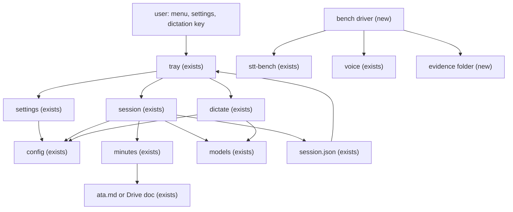
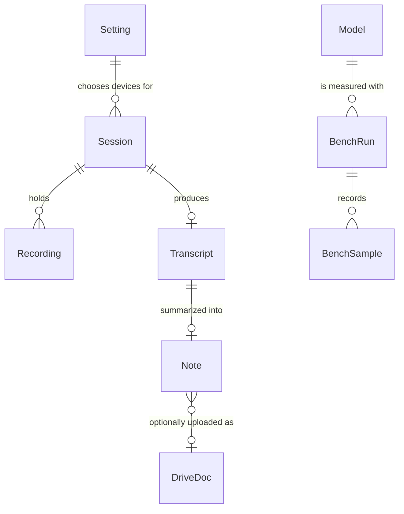
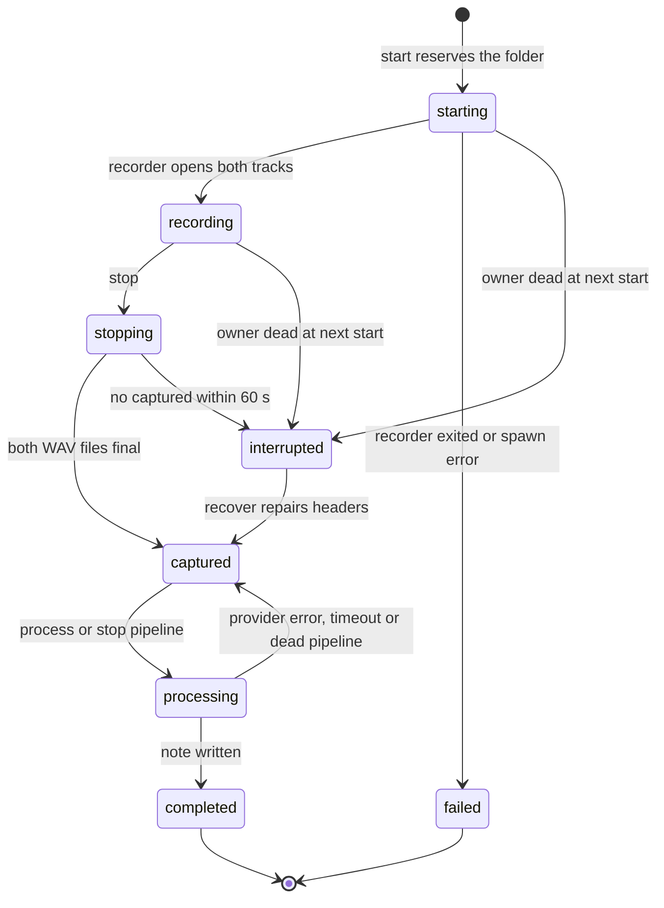

# Windows port completion and Rust performance evaluation

**Approved**: 2026-11-07 - user: "Aprovar com PR" - OpenBot block bea16b12-f0f2-4b5b-9450-f299bc7c0350, action approve_plan_with_pr. Approval covers revision 3 SHA-256 d89179836eb03b28f3c8933cd874a0d0783cc241d6cef742a4ff0bf32abc3efa, Q1/Q2 recommended defaults, the Defaults table, Execution gate and optional Phase C. Merge, tag, publication, real providers and phase A/B preflights remain separate.

Status: approved for separate Checks/Build execution, revision 3 (answers the plan review A1 to D3 and Vera's three residual points, see the last section; revision 1 `07e8f832…a4599`, revision 2 `63af55f2…8032`). Future location `.specs/features/windows-port/plan.md` in `sammyjdev/voxis`.
Repository: `sammyjdev/voxis`, PR #4 (draft), head `889d48c9a2cca7f61a0648b832c3c3ac20953c78`, base `master` at `e2971bf21bfc579bf3cacb207cc97063ecd6fd7a`.
Direction: Sammy, Engineering message `9c2f4997-c0d6-4e9d-80d4-f26fad15a738` (2026-11-07). macOS and Linux come after this phase.
Phase: planning is complete. Execution belongs to a separate Checks/Build session under the approved Execution gate; this planning session creates no product code or tests.

## Problem

The Windows port installs and runs (rc3 installers accepted by Sammy for those bytes only), but the whole port is not shippable.
Rita's static review of the full diff (REQUEST_CHANGES, review 5813331017) found two blockers and four defects, all unreproduced at runtime:

- F17 (blocker): `GET /static/C:/Users/<profile>/file` makes `Path::join` replace the frontend root, so the overlay server returns any file the user account can read, with no token.
- F18 (blocker): two `meetrec meeting` runs in the same minute reuse one folder and `WavWriter::create` truncates the first `mic.wav` and `system.wav`.
- F19: a dead recorder's manifest still counts as active, so every native `start` answers "a session is already active" while the tray offers a new recording.
- F20: the native `config.toml` reader returns `USB Microphone" # desk` for a valid commented line, so the chosen mic silently falls back to the default.
- F21: Anthropic, OAuth and Drive calls have no deadline; a stalled server leaves the session in `processing` with new recording and quit disabled.
- F22: the settings page offers `cmd_r`, `shift_r` and others, saves them with success, and Windows runs `f13` instead.
- F23 (inherited, not a new regression): the tray's liveness check splits the command line on whitespace, so a profile such as `C:\Users\Sam Doe` makes a live recorder look interrupted.

Beyond the findings, the product contract is unwritten. Today a Windows user sees Obsidian vault, categories, LLM command, `STT_MODEL` and `NOISE_REDUCTION` controls that the native binary ignores; dictation logs every transcript in plain text in `%USERPROFILE%\.voxis\logs\dictate-<date>.log` with no retention rule; a failed paste is silent and the text is lost; a replugged microphone leaves dictation deaf; `INSTALL.md` and `BACKLOG.md` still say Windows lives in the `Allyhgf/voxis-windows` fork; the README links "latest release" while rc3 is a draft (Vera re-read it with `gh-dev`: tag at `889d48c`, digests equal to the recorded ones; the default identity returns 404 for a draft, which is not evidence of deletion); and the README privacy text says meeting text goes only to a local LLM CLI, while Windows sends it to the Anthropic API when a key exists.

Performance is also unproven. The PR body cites medians of 0.185 s (CUDA native), 0.249 s (Python) and 0.617 s (another native run). Recalculated from `results[].stt_s` in `C:\Users\samde\.cache\voxis-bench\voice`, 19 spans, 56.83 s of audio: `cuda-f16-prompt` 0.1850956 s, `turbo-pt-b5-prompt` 0.248744 s, `wcpp-f16-prompt` 0.6174064 s. They are historical, not a new run, and they do not show a language effect: the engine (whisper.cpp through `whisper-rs` against faster-whisper/CTranslate2), the prompt text (`bench.py` and `dictate.rs` carry different vocabulary lists), the backend and the VAD all differ, the files carry no host, OS or backend record, and `vram_mib` is `0` in both Python files (a GPU model cannot use 0 MiB, so that is an unavailable counter, not a measurement). The same `wcpp-f16` config also moves from 0.276 s to 0.617 s when a prompt is added, which is unexplained. The reference TSV has 20 lines against 19 spans.

When this ships, a Windows user has a written, tested contract: which commands and settings exist and do what they say, no recording is overwritten or stranded, no file outside the overlay's frontend is readable, provider failures end and keep the data, the docs match the product and the published state, and Sammy has measured numbers (with their limits) for the native stack compared with the Python reference on the same machine, without any gain assumed in advance.

## Shape

Reuses the existing `session`, `minutes`, `models`, `dictate` modules and tray `settings`, the `stt-bench` and `voice.py` harnesses with `voice_score.py`, and the accepted installer layout; adds no new product module, only a benchmark driver. The rules that change outcomes (path containment, folder reservation, liveness, TOML parsing, deadlines, key validation) run in pure functions in the native workspace and the tray crate, which `cargo test` reaches; hardware, hook, clipboard and overlay behavior is proven in the acceptance matrix instead.

1. user acts in the `tray` (exists) - menu, settings window, dictation key; the tray spawns `meetrec` commands and reads `session.json`; liveness uses structured argv, so spaced profile paths match (F23)
2. `settings` (exists) - validates saves; on Windows accepts only keys and values the native binary applies, and shows the rest as unavailable (F22, legacy controls)
3. `session` (exists) - `start`, `stop`, `process`, `recover`: reserves each folder atomically, reconciles dead owners before admission, keeps every file (F18, F19)
4. `config` (exists) - the native reader of `%APPDATA%\voxis\config.toml`, parsed as TOML so it agrees with the tray (F20)
5. `dictate` (exists) - key gestures, energy gate, paste, overlay server with a contained static root (F17), log without transcript text, device and overlay failure exits
6. `minutes` (exists) - Anthropic, OAuth, Drive with finite deadlines; `ata.md` written locally before any Drive call (F21)
7. `models` (exists) - pinned model and VAD lookup; a download already goes through `<name>.part` and a hash check, and this plan adds an on-demand `--verify` that re-checks a present file (A2); pins unchanged
8. `bench driver` (new) - runs `stt-bench` (exists) and `voice.py` (exists) in counterbalanced blocks with raw JSON, hashes, host and build provenance and resource sampling; `stt-bench`, `voice.py` and `voice_score.py` change only as criterion 87 lists (B2)
9. out: `session.json` (exists) read by the `tray` on its 2-second poll; transcripts, `ata.md` or the Drive `.url` on disk; benchmark evidence under the evidence folder

**Changes underneath**

| Front | What changes |
| --- | --- |
| domain | `active session` meant "manifest state is starting, recording, stopping or processing"; it now also requires a live owner process. `session.rs` `start`, the tray `derive_state` and any CLI reader branch on it today |
| domain | `supported on Windows` has no definition today; it becomes the Surface tables and the criteria below, and the settings window branches on it |
| stored data | `session.json` schema 1 keeps every field and state; only new `error.code` values are added (`owner_died`, `provider_timeout`, `disk_write_error`). Existing sessions: nothing to migrate |
| stored data | persisted `laris-settings.json` and `config.toml` values that Windows does not apply are left byte-identical, never rewritten or deleted |
| stored data | `meetings/<YYYY-MM-DD_HHMM>` folders gain an optional `_N` suffix on collision; existing folders keep their names |
| readers | tray tooltips and menu rows read the new `interrupted` and `captured` derivations; the settings window reads the Windows key list and the unavailable notices; `voice_score.py` reads benchmark JSON schema 2 and still reads schema 1 files |
| readers | README, `INSTALL.md`, `BACKLOG.md` and the developer notes carry the Windows statements below |
| domain | `dictate exited` meant "respawn, up to 3 attempts"; exit code `3` now means "input device lost, do not respawn" - the tray's `should_respawn` and its dictation row branch on it (criterion 44) |
| stored data | `meetrec models fetch` gains `--verify`; plain `fetch` keeps its name-based `ready` and does not hash (criterion 48) |
| stored data | a Drive file created by `minutes` carries `appProperties` `voxis_session=<id>` (door 8); existing Docs are untouched |

New: `BenchRun` and `BenchSample` (the evidence records of the performance evaluation, stored as JSON and a markdown report, not in the product). Nothing else is added to stored product data. One-way constraints: `session.json` schema 1 field set and state names (door 1), session folder naming (door 3).

## Surface

The overlay's HTTP server is the only network surface whose signature changes (loopback only, ephemeral port):

| Route | In | Out | Status | Who |
| --- | --- | --- | --- | --- |
| `GET /static/<path>` | a path relative to the frontend root | file bytes, or `bad path` / `not found` | `200`, `400`, `404` | anyone who can reach the loopback port; only files under the canonical frontend root are readable |
| `POST /theme` | theme updates, `token=<token>` query | theme JSON | `200`, `403`, `422` | the tray and the overlay page, which hold the token; everyone else gets `403` |

Unchanged routes keep their behavior: `GET /overlay` without token returns `200`, `GET /theme` and `GET /ws/voice` require the token.

The command and tray surface that Windows exposes after this plan (Sammy confirms or edits it at approval; no entry is removed silently):

| Entry | Windows status | Contract after this plan |
| --- | --- | --- |
| tray menu: Gravar reunião, Parar gravação, Processar gravação, Recuperar gravação, Última nota, Ditado and its model retry row, Hands-free, Orb submenu, Iniciar com o Windows, Configurações..., Sair | supported | unchanged wiring (owner-accepted without automated proof); states follow the state diagram; Sair stays disabled while a session is starting, recording, stopping or processing |
| `meetrec devices [--json]` | supported | feeds the Áudio settings; unchanged output keys `inputs`, `outputs`, `default_input`, `default_output` |
| `meetrec start`, `stop`, `process <id>`, `recover <id>` | supported (tray-driven, also usable from a shell) | last stdout line `note: <path>`; exit `0` or `1`; folder and owner rules (criteria 12, 17, 86) |
| `meetrec models fetch [--verify]` | supported | pinned download through `.part` and a hash check; `--verify` re-hashes present files (criteria 48, 49); plain `fetch` unchanged |
| `meetrec dictate` | supported (tray-driven) | gestures, paste, overlay, log rules below |
| `meetrec meeting [mic]` | supported as the standalone interactive meeting command | collision-safe; kept public because removing a shipped command is Sammy's call, recommended keep |
| `meetrec record`, `transcribe`, `summarize` | developer commands, documented only in developer notes | `record` refuses a folder that already holds recordings |
| `meetrec miris.recorder`, `miris.pipeline` | internal markers the tray matches on | not user commands; names unchanged |
| `stt-bench`, `keyprobe` | developer tools, not in the installers | `stt-bench` output schema 2 below |

## Landing

| One-way door | Literal shape | Alternative rejected |
| --- | --- | --- |
| `session.json` contract shared with the tray and Python MIRIS | `schema_version: 1`; fields `state`, `recorder_pid`, `processing_pid`, `error{code,message,occurred_at}`, `channels`, `note_path`, `transcript_ready` unchanged; states `starting recording stopping captured processing completed failed interrupted`; new `error.code` values only | schema 2 - the tray logs "unsupported manifest schema" and skips the session, so every existing reader would lose sessions |
| TOML parser dependency in the native workspace | `toml_edit` (the crate the tray already uses for the same file) in `meetrec/Cargo.toml`, lock updated, covered by the dependency audit | extend the hand-written line parser - it is the F20 bug class; `toml` + serde - heavier derive layer for three keys |
| session and meeting folder naming | `sessions/<YYYYMMDD-HHMMSS>` (15 characters, validated by `session_dir`); `meetings/<YYYY-MM-DD_HHMM>` then `_2` to `_99` on collision | random or UUID suffix - breaks the 15-character id check the tray and `process`/`recover` use, and loses lexical ordering |
| CLI output contract the tray parses | last stdout line `note: <path>` after the pipeline; exit `0`/`1`; `devices --json` keys unchanged | JSON-on-stdout - the tray reads the last line today |
| Windows settings contract | `DICTATE_KEY` in `f5`..`f15` on Windows, default `f13`; keys the platform does not apply are rejected on save and preserved on disk | silently migrating a saved `cmd_r` to `f13` - it rewrites the user's file and hides the change |
| benchmark result schema 2 (additive) | keep `config`, `vram_mib`, `load_s`, `results[{start_s,audio_s,hyp,lang,stt_s}]`; add `schema: 2`, `backend`, `host`, `cpu_s`, `peak_rss_mib`, `vram_peak_mib`, each unavailable value `null` plus a `<field>_unavailable` reason string | a new format - breaks `voice_score.py` and the 10 historical files |
| process identity dependency in the native workspace (door 7) | `sysinfo` in `meetrec/Cargo.toml`, the crate the tray already uses on Windows, reading `exe()` and `cmd()` per pid (criteria 12, 85) | a new manifest field with the process start time - changes the `session.json` contract (door 1); reading another process's memory through `NtQueryInformationProcess` - undocumented layout |
| Drive idempotency key (door 8) | the uploaded file carries `appProperties: {voxis_session: <session id>}`; a retry lists the folder with `appProperties has { key='voxis_session' and value='<id>' }` before it uploads (criterion 89) | matching on the title - titles repeat; a local marker file only - cannot see an upload that completed after the timeout |

- Nothing else in this change is hard to reverse. Timeout values, log wording and notice texts are reversible and settled in the diff.

## Criteria

Slices S1 to S9 are the Windows closeout; S10 is the performance evaluation. Items marked (Rec) carry a recommendation that Sammy confirms or changes at approval (see Assumptions and Decisions). The red-before-green rule for security and data-loss items is criterion 64. Criteria 85 to 92 (S11) were added by the plan review and name the slice they belong to; numbers 1 to 84 are unchanged so the review's references still hold.

### S1: The overlay server serves only its frontend, F17 (P1)

A local client can read the orb page and its assets and nothing else.

**Acceptance Criteria**

1. WHEN a client requests `GET /static/<path>` and the canonical target of `<path>` lies under the canonical frontend root THEN the overlay server SHALL answer `200` with that file's bytes
   - `/static/overlay.js` → 200; a file in a subfolder of the root → 200
2. IF `<path>`, after percent-decoding and with its segments split on both `/` and `\`, is absolute, drive-prefixed, rooted, UNC, a reserved device name (`CON`, `NUL`), carries an alternate data stream (`overlay.html:stream`), or contains a `..` segment THEN the overlay server SHALL answer `400` `bad path` and open no file
   - `/static/C:/Users/x/sentinel.txt` → 400; `/static/%2e%2e/sentinel.txt` → 400; `/static/%5C%5Chost%5Cshare%5Cf` → 400; `/static/NUL` → 400; `/static/overlay.html:stream` → 400; a harmless sentinel outside a temporary root is never returned
3. IF a relative `<path>` resolves through a link or junction inside the root to a target outside the canonical root THEN the overlay server SHALL answer `404` and return no bytes
4. IF `VOXIS_FRONTEND` names a directory that does not exist THEN `/overlay` and every `/static/*` request SHALL answer `404`
5. WHEN `GET /overlay` is requested without a token THEN the overlay server SHALL answer `200` with the installed page (rc3 behavior kept)
6. IF a `GET` or `POST` to `/theme` carries no `token=<token>` THEN the overlay server SHALL answer `403` and `orb-theme.json` SHALL stay byte-identical

### S2: No recording is ever overwritten, F18 (P1)

**Acceptance Criteria**

7. WHEN `meetrec meeting` reserves its folder THEN it SHALL create the folder with a create-new call that fails if the path exists, never `create_dir_all` on an existing path
8. IF `meetings/<YYYY-MM-DD_HHMM>` already exists THEN `meetrec meeting` SHALL reserve `<...>_2`, then `_3`, up to `_99`, and exit `1` with `no free session folder` after that
   - first run in a minute → `2026-11-07_1432`; second run in the same minute → `2026-11-07_1432_2` and the first folder's `mic.wav` hash is unchanged; a 100th collision → exit 1
9. IF `meetrec record <dir>` targets a folder that already contains `mic.wav` or `system.wav` THEN it SHALL exit `1` before opening any writer and leave both files byte-identical
   - missing folder → created and used; existing empty folder → used; folder with only `system.wav` → exit 1
10. WHEN `start` creates `sessions/<YYYYMMDD-HHMMSS>` THEN it SHALL fail with exit `1` if that folder exists and SHALL NOT reuse it
11. WHEN `recover <id>` runs THEN it SHALL change only the header size fields of a WAV whose header declares zero data, and the sample bytes after the header SHALL stay identical
   - a WAV with a valid header → file byte-identical; a killed recorder's WAV → header fixed, sample bytes identical

### S3: Sessions recover and never block a new recording, F19 and F23 (P1)

**Acceptance Criteria**

12. WHEN `start` runs and the newest session in `starting`, `recording`, `stopping` or `processing` has a live owner THEN `start` SHALL exit `1` with `a session is already active: <dir>` and create nothing
    - a live owner is a process whose image is this `meetrec` and whose argv elements are the marker and the session folder, compared as separate elements
13. IF the recorder of a session in `starting`, `recording` or `stopping` is not a live owner THEN `start` SHALL write state `interrupted` with `error.code` `owner_died`, keep every file in the folder, and create the new session
    - recorder dead → interrupted and a new session starts; the pid reused by an unrelated `notepad.exe` → treated as dead; a live recorder → refused by criterion 12
14. IF the pipeline of a session in `processing` is not a live owner THEN `start` SHALL write state `captured`, keep every file, and offer `process <id>` on it, as the tray's derivation already does
15. WHEN the session folder path contains spaces or non-ASCII characters (`C:\Users\Sam Doe\.miris\sessions\20261107-143200`) THEN the tray SHALL show a live recorder as `Recording` and not `Interrupted` (F23, Rec: included)
    - the argv is compared element by element on Windows; a second unrelated process with a reused pid and a different argv → not live
16. IF the recorder process has exited before the manifest reaches `recording` THEN `start` SHALL write state `failed` with `error.code` `recorder_error`, exit `1`, and leave no session in `starting`
17. IF `stop` does not see `captured` within 60 s THEN `stop` SHALL terminate the recorder it started after verifying its identity as in criterion 12, then write state `interrupted` with `error.code` `recorder_timeout`, and `mic.wav` and `system.wav` SHALL stay recoverable by `recover <id>`
    - recorder ended by `stop` → `interrupted`, and `start` opens a new session; recorder that cannot be ended → state stays `stopping`, exit 1 `recorder did not stop; owner still live`, and `start` refuses by criterion 12
18. IF a WAV write fails during recording (disk full) THEN the recorder SHALL finalize the headers of the data already written, set state `failed` with `error.code` `disk_write_error`, and keep both files
19. The system SHALL NOT delete, move or compress any file in a session folder, `meetings/` folder or log folder on its own (no automatic retention in this phase)

### S4: Settings and configuration tell the truth, F20, F22 and legacy controls (P1)

**Acceptance Criteria**

20. WHEN a native command reads `config.toml` THEN it SHALL parse the file as TOML and return, for `mic`, `speaker` and `minutes_model`, the same value the tray's reader returns
    - `mic = "USB Microphone" # desk` → `USB Microphone`; `mic = 'USB Mic'` → `USB Mic`; `mic = "A \"B\""` → `A "B"`; a `mic` key inside another table → ignored; empty value → default device
21. IF `config.toml` is not valid TOML THEN native commands SHALL print `config.toml invalid: <parser message>` to stderr, use the default devices and the default minutes model, and not exit (Rec)
22. WHEN the settings window opens on Windows THEN the dictation key list SHALL offer exactly `f5` to `f15` and preselect the key the daemon will use, `f13` when none is saved or the saved key is unsupported
23. IF `save_laris_settings` receives a `DICTATE_KEY` outside `f5`..`f15` on Windows THEN it SHALL return an error naming the key and write nothing
    - `shift_r` → error, file unchanged; `f13` → saved
24. IF the saved `laris-settings.json` holds an unsupported `DICTATE_KEY` such as `cmd_r` THEN the settings window SHALL show `Tecla cmd_r não é suportada no Windows; usando F13` and the file SHALL stay byte-identical until the user saves
25. WHILE running on Windows the settings window SHALL show the Vault, Comando LLM, Categorias, Modelo STT and Redução de ruído controls disabled with the text `Não disponível no Windows`, the Ditado form SHALL leave `STT_MODEL` and `NOISE_REDUCTION` out of the `save_laris_settings` call, and their saved values SHALL stay byte-identical (Rec)
    - saving `f13` from the form on Windows → success, and `laris-settings.json` keeps its `STT_MODEL` and `NOISE_REDUCTION` entries byte-identical
26. IF `save_laris_settings` receives `STT_MODEL` or `NOISE_REDUCTION` from any caller, or `save_miris_config` is called, on Windows THEN it SHALL return `unsupported on Windows: <key>` and write nothing, while a call that carries only `DICTATE_KEY`, `ASSISTANT_MODE` and `INITIAL_PROMPT` SHALL succeed
27. WHEN the user saves `ASSISTANT_MODE` or `INITIAL_PROMPT` on Windows THEN the next `dictate` start SHALL use them (`always_on` starts hands-free; an empty prompt disables priming)
28. WHEN the user saves the Áudio selection THEN the next meeting and the next dictation start SHALL record from that mic and loopback from that speaker
    - a named device that is absent → fallback to the system default with a warning line in `recorder.log` or the dictation log, and the meeting still records

### S5: Provider calls end and keep the data, F21 and destinations (P1)

**Acceptance Criteria**

29. WHEN `minutes` calls Anthropic, the OAuth token endpoint, Drive folder list or create, or Drive upload THEN each call SHALL carry a finite deadline: connect 10 s; Anthropic 300 s; OAuth 30 s; Drive list and create 30 s; Drive upload 120 s (defaults, Rec)
30. IF a call exceeds its deadline THEN `minutes` SHALL return an error that names the provider and the deadline, the pipeline SHALL set the session to `captured` with `error.code` `provider_timeout`, and `transcript.md` and any `ata.md` SHALL remain
    - a loopback fake that accepts and stalls → error after the deadline and `captured`; a malformed response → `captured` with the provider error, same files kept
31. IF the Drive upload times out THEN the error text SHALL say the upload may already have completed and name the Drive folder `VOXIS Atas`, and `ata.md` SHALL remain; a retry follows criteria 88 and 89
32. WHEN minutes are generated THEN the system SHALL write `ata.md` in the session folder before the first Drive call
33. WHERE `anthropic_api_key` is absent THEN the session SHALL complete with `transcript.md` as its note and make no network call; WHERE Google credentials are absent THEN it SHALL complete with `ata.md` as its note (behavior kept, tests exist)
34. WHERE both Google files exist and Drive succeeds THEN the note SHALL be the `.url` shortcut to the Google Doc in `VOXIS Atas` (behavior kept)

### S6: Dictation, overlay and privacy (P1 for 35-39, P2 for 40-45)

**Acceptance Criteria**

35. WHEN the user holds the dictation key for at least 250 ms and releases it with more than 300 ms of captured audio THEN `dictate` SHALL transcribe it and paste the text followed by one space into the focused window
36. IF the key is released within 250 ms THEN `dictate` SHALL paste nothing, and WHEN a second such tap is released within 450 ms of the first THEN it SHALL enter hands-free
37. WHILE hands-free is on, WHEN the energy gate sees at least 400 ms of speech followed by 700 ms of silence THEN `dictate` SHALL transcribe and paste that utterance, and the 30 s utterance limit SHALL close a longer one
38. WHEN any press of the dictation key arrives during hands-free THEN `dictate` SHALL turn hands-free off, transcribe and paste speech it cut mid-utterance when that speech is at least 400 ms, and ignore that press's release
39. WHEN an utterance is transcribed THEN every sink of `dictate` (the `dictate-<date>.log` file, its stdout and stderr, and the tray's `laris.log` and `laris.log.1`, which capture them) SHALL hold the mode (`ptt` or `hf`), the audio seconds, the processing seconds and the character count, and SHALL NOT hold the transcript text (Rec)
    - logs written by earlier builds stay where they are; criterion 56 documents their removal
40. WHEN a paste runs THEN `dictate` SHALL put the text on the clipboard, send Ctrl+V, wait 250 ms and restore the previous clipboard text (behavior kept)
41. IF `SendInput` reports fewer than 4 injected events THEN `dictate` SHALL leave the dictated text on the clipboard, skip the restore, and log `paste failed: injected <n> of 4`
42. IF the clipboard cannot be opened or set THEN `dictate` SHALL log `paste failed: clipboard <error>` without the text and return the orb to hidden
43. IF the orb window or WebView2 cannot be created THEN `dictate` SHALL keep running without the overlay and log `overlay unavailable: <error>` (Rec)
44. IF the input stream reports an error such as an unplugged device THEN `dictate` SHALL log `microfone desconectado: <error>`, hide the orb, and exit with code `3`; WHEN the tray sees that exit code THEN it SHALL NOT respawn `dictate` (the 3-attempt respawn cap applies to other exit codes only), SHALL show `Ditado: microfone desconectado` in the dictation row, and WHEN the user clicks that row THEN it SHALL start `dictate` once (Rec; automatic reopen is out of scope)
    - mic unplugged → exit 3, no respawn, row text shown; click after replug → one start; click with the mic still absent → exit 3 again and the row text again
45. IF the default input format is neither `f32` nor `i16`, or the model fails to load, THEN `dictate` SHALL log the reason (`formato de áudio não suportado: <format>` or `modelo não carregou: <path>: <error>`) and exit `1` instead of panicking

### S7: Hardware, backend and model recovery (P2)

**Acceptance Criteria**

46. WHEN a model loads in `dictate`, `transcribe` or `stt-bench` THEN the backend it selected (`CUDA0`, `Vulkan0` or `CPU`) SHALL be recorded, read from the `using <name> backend` line whisper.cpp writes: by the bench driver from the captured stderr of `stt-bench` and `transcribe`, and by `dictate` through the whisper-rs logging hook when the pinned version exposes it; otherwise `null` with a reason (no product code is added only to print it)
47. IF the GPU backend fails to initialize and whisper.cpp falls back to the CPU THEN `dictate` SHALL log `sem GPU: usando CPU` and the benchmark JSON SHALL carry `backend: "CPU"`
48. WHEN `meetrec models fetch --verify` runs THEN it SHALL hash each present model file against its pin and, for a file that differs, download to `<name>.part`, verify the pin, and only then replace the file; plain `meetrec models fetch` SHALL keep today's name-based `ready` and SHALL NOT hash
    - trigger: the flag, and the tray's model retry row after a `modelo não carregou` exit (criterion 45); never on a tray start or a `dictate` start; cost: one read of both files (about 1.6 GB), whose duration row M2 records and this plan promises no number for
49. IF a `--verify` download is cut or the disk is full THEN `meetrec models fetch` SHALL leave the pre-existing file untouched under its name, delete only its own `.part`, exit `1`, and write nothing under the final name that it did not verify
    - corrupt old file and a cut download → old file kept, exit 1, dictation stays not ready with `modelo não carregou`; no old file and a cut download → no file under the final name
50. The README and `INSTALL.md` SHALL name the verified Windows configuration (Windows 11 x64, NVIDIA GeForce RTX 4070 Ti, CUDA 13.3.1 edition, Vulkan edition transcription on that host) and list Windows 10, ARM64, AMD and Intel GPUs, other NVIDIA generations and other audio devices as not tested

### S8: Documents and release claims match the product (P1)

**Acceptance Criteria**

51. WHEN the PR is marked ready THEN no document SHALL describe Windows as an external fork or as removed from this repository, except history lines that carry their own date (`BACKLOG.md` lines 7 to 10 and its dated triage entries); `INSTALL.md` lines 11 and 12 SHALL be replaced by a pointer to the Windows install section
52. WHEN the PR is marked ready THEN the README download statement SHALL match `gh release view` read in the same session with an identity that can see drafts (`gh-dev`; the default identity returns 404 for a draft): `releases/latest` only if a non-draft release exists, otherwise the tag and the words "release candidate, not published"; an unreadable release is reported as unverified and never inferred
53. The README Windows section SHALL give the measured installer sizes (CUDA 523,385,745 bytes, Vulkan 9,641,882 bytes at rc3) or the current asset sizes, and SHALL label the GPU generations and "Fastest" as vendor-stated or measured by S10
54. The README SHALL state for Windows: dictation key `f13` by default and `f5` to `f15` selectable; model `ggml-large-v3-turbo` with the Silero VAD; notes go to `ata.md` or a Google Doc, not to Obsidian; hands-free uses an energy gate, not Silero
55. The README privacy section SHALL state what leaves a Windows machine: transcript text to the Anthropic API when `anthropic_api_key` exists, the minutes to Google Drive when both Google files exist, nothing else; it SHALL NOT claim `0600` permissions on Windows
56. The README and `INSTALL.md` SHALL state where Windows keeps audio, transcripts, notes and logs (`%USERPROFILE%\.miris\sessions`, `%USERPROFILE%\.voxis\meetings`, `%USERPROFILE%\.voxis\logs`), that nothing deletes them automatically, and how to remove them by hand
57. The `INSTALL.md` file SHALL state that the app folder `%LOCALAPPDATA%\VOXIS` and the data folder `%LOCALAPPDATA%\voxis` are the same folder on case-insensitive Windows, that uninstall keeps the models, and the layout stays unchanged
58. The developer notes SHALL state that Git Bash rewrites `/S` and `/v` and give `MSYS2_ARG_CONV_EXCL='*'` or `//S` and `//v` as the fix
59. The README SHALL state that dictation replaces non-text clipboard contents (image, files), that Windows blocks injected keys into windows running as administrator without telling the sender, and what VOXIS does then (criterion 90)
60. The README claim "0 known vulnerabilities in the shipped tray" SHALL name the lockfiles the audit workflow scans; IF `spikes/windows-rust/Cargo.lock` (405 locked packages) is not scanned THEN the README SHALL say the native binary is not covered (Rec: add it to the workflow)

### S9: Verification, immutability and the acceptance matrix (P1)

**Acceptance Criteria**

61. WHEN immutability is verified THEN the verifier SHALL read the tag and the release with `gh-dev` and find tag `v0.2.0-rc3` still at `889d48c9a2cca7f61a0648b832c3c3ac20953c78` and the draft assets unchanged (CUDA asset 719717274 sha256 `09904720…e5d2`, Vulkan asset 719717270 sha256 `870873e7…f3878d`)
    - if the release cannot be read at verification time, the report says unverified; deletion or publication is never inferred
62. IF a change alters shipped executable bytes, packaging, workflow or runtime inputs THEN the candidate SHALL be a new tag chosen by Sammy, built by CI from a new reviewed SHA into a draft release, and the rc3 acceptance SHALL be reported as valid for the original rc3 bytes only
63. The system SHALL keep CUDA 13.3.1, the model pins (`ggml-large-v3-turbo.bin` sha256 `1fc70f77…2bc69`, `ggml-silero-v5.1.2.bin` sha256 `29940d98…4ea2cf` and their pinned URLs), the per-user NSIS layout and the owner-accepted menu wiring unchanged, shown by an empty diff on those lines
64. WHEN a criterion in S1 to S5, or criterion 18, 49 or 86, protects against file disclosure, data loss or a stuck session THEN a test written from the criterion SHALL fail at the frozen SHA before the production change and pass after it, committed in the same change
65. WHEN the fixes are done THEN Rita SHALL review the diff independently and Vera SHALL verify the matrix below; Dani and Felix SHALL NOT review or verify their own changes
66. The system SHALL keep the existing native suite (25 tests), the tray suite (61 on Windows, 56 on Linux) and the Python suites (laris 250 passed, 1 deselected; miris 100 passed) green, SHALL change no file under `packages/` and no macOS or Linux build or packaging file, and SHALL change no behavior on macOS or Linux: every shared-tray change either sits behind `cfg(windows)` or leaves the non-Windows path (`ps -o command=`, the `cmd_r` key list) as it is
    - allowed lock change: `spikes/windows-rust/Cargo.lock` gains entries for `toml_edit`, `sysinfo` and the transitive packages they need, no package already in the lock changes version, and the `whisper-rs` and `ggml` entries stay as they are; IF resolution cannot satisfy that THEN the builder reports it and widens nothing silently
67. WHEN the matrix runs THEN each row SHALL end PASS, FAIL or BLOCKED with the raw command output, exit code and source SHA retained, and the host (Windows build, GPU, driver) recorded
68. The PR SHALL stay a draft, and no merge, publication, tag or asset change SHALL happen without Sammy's separate decision; the red macOS `GrantMic.app` job is reported as pre-existing and unclassified, and the PR is never described as all green while it fails

**Acceptance matrix (frozen at approval; one Windows 11 x64 NVIDIA host)**

| Row | Scenario | Evidence |
| --- | --- | --- |
| M1 | fresh per-user install of the CUDA edition; Vulkan edition transcribes | exit codes, registry entry, transcript |
| M2 | first-run model download; `models fetch --verify` on a corrupted copy in an isolated models folder, with and without a cut download; a profile path that has spaces | log, hashes, hash duration |
| M3 | hold and release the dictation key into a text box the tester owns | pasted text; `dictate-<date>.log`, `laris.log` and `laris.log.1` free of utterance text |
| M4 | double-tap hands-free, three utterances, any press ends | three pastes, no extra |
| M5 | `f5`, `f13`, `f15` as the key; `shift_r` rejected; saved `cmd_r` notice | settings screens, file hash |
| M6 | meeting with mic and output loopback for 2 minutes, stop, local transcript | two WAV files, `transcript.md` |
| M7 | kill the recorder, then `start`, `recover`, `process` | state sequence, file hashes |
| M8 | kill the pipeline during transcription, then `process` | `captured`, then `completed` |
| M9 | profile path `C:\Users\Sam Doe`-style folder via `MIRIS_HOME` | tray shows Recording |
| M10 | loopback fake provider that stalls, returns junk, fails after `ata.md` | bounded error, kept files |
| M11 | unplug the microphone during dictation, then reconnect | exit code 3, tray not ready |
| M12 | overlay sentinel test with drive-prefixed, rooted, UNC and `..` paths | statuses, sentinel never served |
| M13 | two `meeting` runs in one minute | two folders, first hash unchanged |
| M14 | uninstall | models and sessions kept |
| M15 | paste into a window running as administrator; clipboard that held an image | recorded result (criterion 90), no assumption |
| M16 | overlay junction case: a junction (`mklink /J`, no privilege needed) inside a temporary root that points outside it | statuses, sentinel never served |
| M17 | failure injection table (disk full, partial injection, WebView2 failure, unsupported sample format, GPU init failure) | named tests, marked unit-proven only, not forced on the host |

Rows that record, install, use the keyboard hook or the clipboard, or start a process of this product run inside the Execution gate below; the gate grants nothing outside the preflights it names.

### S10: Rust performance evaluation, reproducible and without a pre-set target (P1)

The evaluation measures stacks on one machine. It never reports a language effect unless an ablation isolating the language exists (Out of scope). Two layers, never mixed: layer 1 is the engine microbenchmark (`stt-bench` and `voice.py` on the scripted corpus, no VAD, local builds); it characterizes the stack and is not product performance. Layer 2 is candidate product performance (dictation release-to-paste and meeting stop-to-transcript through the shipped code) and uses the candidate's bytes only.

**Acceptance Criteria**

69. WHEN the evaluation is approved THEN the team SHALL write `perf-protocol.md` (inputs, variants, run counts, metrics, claim rule) and record its SHA-256 before the first measured run; IF the protocol changes afterwards THEN it SHALL be saved as a new version with the reason and every earlier run kept
70. The evaluation SHALL use one corpus: audio SHA-256 `879813CB7D985C288BE6F2DF6D7B0502495054AECA4E2C42A9FE9EDA2CE4DD7C` (19 spans, 56.83 s), spans SHA-256 `26E7CD855321DFE36520EA60A9EE9049B50BB42A9389027899DFB996A67FA525`, reference `scripts/stt_bench/voice-phrases.tsv` (20 lines); IF a recomputed hash differs THEN it SHALL stop with `corpus mismatch` and run nothing
71. WHEN the layer 1 variants run THEN they SHALL use compatible models and settings: the native variants load the pinned `ggml-large-v3-turbo.bin`, the Python variant loads faster-whisper `large-v3-turbo` at float16 (the same release in a different weight format; the report names both and does not call them identical), all use `pt`, beam 5, no previous-text context and no VAD, and one prompt: the text of `DEFAULT_PROMPT` in `dictate.rs` saved as `prompt.txt` with its SHA-256, read by `stt-bench` through `STT_PROMPT` and by `voice.py` through the new `STT_PROMPT_FILE`; a second table runs the same variants with no prompt, because the historical `wcpp-f16` median moved from 0.276 s to 0.617 s when a prompt was added
72. The evaluation SHALL compare, on the same host, the native Windows CUDA build, the native Windows Vulkan build and the Python reference (`voice.py` config `turbo-pt-b5-promptfile`, new, and `turbo-pt-b5` for the no-prompt table); IF a variant cannot run on that host THEN the report SHALL say `unavailable: <exact error>` and compare no other operating system
73. WHEN a variant runs THEN it SHALL write raw JSON in schema 2 to a per-run folder with the exit code, stderr, binary or package hash, source SHA, `backend`, the build record (CUDA toolkit version, `CUDAARCHS` list, whisper.cpp commit from the lock, cargo profile and features, rustc version; a local CUDA 13.5 build with `CUDAARCHS=89` is not the shipped 13.3.1 build for `75;86;89;120`, and the report says so), and the host record (CPU, RAM, GPU, driver, Windows build, power plan); a field it cannot read SHALL be `null` with a reason and SHALL NOT be `0`
74. WHEN the per-sweep numbers are computed THEN the report SHALL give, for each variant, warm per-span p50 and p95 over all sweeps, total processing time divided by total audio time per sweep (RTF), and the cold time from process start to ready, with run counts and min, median and max across runs
75. WHEN a variant runs THEN the driver SHALL sample CPU time, peak working set and GPU memory (NVML or `nvidia-smi`) at a documented interval, and a counter the host does not provide SHALL be reported unavailable, never zero
76. WHEN the runs execute THEN the driver SHALL run 6 blocks serially, each block one process per variant (V1 native CUDA, V2 native Vulkan, V3 Python) in a different one of the 6 orderings of the three, and each process SHALL do one cold start, the explicit warm-up and 10 in-process warm sweeps, with no other heavy workload (Rec)
    - the 6 blocks use all 6 permutations, so every variant runs in every position twice; the unit of analysis is the process, and pairing is by block
77. WHEN a difference between two variants is reported THEN the report SHALL call it a difference only if the sign of the per-block difference of the process's warm p50 is the same in all 6 blocks (and likewise for RTF and for cold time, each judged alone), and otherwise `no consistent difference`; the 10 sweeps inside a process are reported as dispersion, not as pairs (claim rule written in the protocol before the runs; Rec)
78. WHEN quality is scored THEN `voice_score.py` SHALL report WER, CER, technical-term recall, empty outputs, repeated n-grams and omitted reference words with one normalization and one reference for all variants, and SHALL read `hyp` from the same spans
    - 19 spans against 20 reference lines → score the concatenated text, state the mismatch, drop nothing
79. WHEN the silence control runs THEN the driver SHALL transcribe a generated 10 s digital-silence clip and a generated 10 s noise clip with every variant and report each non-empty output, with the generated files' hashes recorded
80. WHEN dictation latency is measured, on the candidate bytes only and never reused from rc3 or `889d48c`, THEN the dictation log SHALL carry the key-release and paste-complete timestamps (no text), and the report SHALL give the p50 and p95 of release-to-paste over the utterances the owner reads from `voice-phrases.tsv` into the test text box, kept separate from engine latency (Rec: owner-in-the-loop)
81. WHEN meeting latency is measured, with the shipped `meetrec` of the candidate installer and never reused from older bytes, THEN the report SHALL give the time from the recording stop to `transcript_ready` for a stored two-track fixture, separately from any provider time, and provider calls SHALL use loopback fakes unless Sammy authorizes a real call for a separate table
82. IF a measurement needs a real provider, free speech from the owner, or any action the Execution gate lists as per-phase or never THEN it SHALL run only inside the approved gate; evidence MAY hold `hyp` text of the scripted corpus (the `voice-phrases.tsv` phrases) but SHALL hold no audio, no free speech, no meeting content and no dictation text, and audio stays in its local folder with its hash recorded
83. The report SHALL present the numbers, the host, the limits and the trade-offs for Sammy's decision, and SHALL NOT state a speed or accuracy target, a regression allowance or a "Rust is faster" sentence that the protocol did not define
84. WHEN the layer 1 engine inputs are unchanged between the layer 1 baseline `H` and the fix candidate THEN one layer 1 evaluation at `H` SHALL stand for the engine, and otherwise it is re-run on the candidate; `H` is `889d48c` plus the harness commit of criterion 87, never `889d48c` alone, and its exact SHA is recorded in the protocol; the engine inputs are the `stt-bench` sources, the `whisper-rs`, `whisper-rs-sys` and `ggml` entries of the native lock, the native workspace features and cargo profile, the CUDA toolkit version and `CUDAARCHS` list of the build record, `prompt.txt` and the model pins, shown by an empty diff from `H` to the candidate on exactly those paths and values; layer 2 (criteria 80 and 81) always runs on the candidate's new bytes (Rec)

### S11: Additions from the plan review, each tagged with its slice (P1)

**Acceptance Criteria**

85. WHEN `meetrec` checks whether a recorder or pipeline owns a session THEN it SHALL read the process image path and the argv elements through `sysinfo` and call the owner live only if the image is this `meetrec` and the argv is exactly the marker and the session folder (S3, C5)
86. WHEN `process <id>` or `recover <id>` targets a session whose owner is live THEN the command SHALL exit `1` with `session is active: <dir>` and change nothing, and `stop` SHALL write its stop file only after verifying the recorder identity (S3, C5, A6)
87. WHEN layer 1 is implemented THEN exactly these files SHALL change: `stt-bench/src/main.rs` (flags `--sweeps N` and `--out`, schema 2 with per-sweep arrays, `load_s` split into `load_s` and `warmup_s`, a `READY <unix_ms>` stdout line after the warm-up, prompt from `STT_PROMPT`), `scripts/stt_bench/voice.py` and `bench.py` (the same flags and schema, `STT_PROMPT_FILE`, the new config `turbo-pt-b5-promptfile`), `scripts/stt_bench/voice_score.py` (p95, CER, repeated n-grams, omissions; reads schema 1 and 2) and a new `scripts/stt_bench/perf_driver.py`; the resource sampler runs in the driver (`psutil` in the isolated venv, `nvidia-smi --query-compute-apps` for GPU memory), and neither engine gains product code; these changes land as one harness commit on top of `889d48c`, whose exact SHA is recorded in the protocol and is the layer 1 baseline `H` (criterion 84) (S10, B2)
    - cold time is the driver's spawn timestamp to the `READY` line; adding a VAD to `stt-bench` is out of scope, so layer 1 stays a no-VAD stack measurement
88. WHEN `process <id>` runs on a session whose `transcript_ready` is true THEN it SHALL reuse `transcript.md` if it is non-empty and newer than `mic.wav` and `system.wav`, and SHALL reuse `ata.md` if it exists and is newer than `transcript.md`, so a retry makes no provider call for a step that already finished (S5, C4; Rec)
    - transcript fresh and `ata.md` missing → only minutes run; a WAV newer than the transcript → the full pipeline runs
89. WHEN `minutes` uploads to Drive THEN it SHALL first list the `VOXIS Atas` folder for a file with `appProperties` `voxis_session=<id>`, reuse its link if one exists, and otherwise create the file carrying that property (S5, C4)
    - an upload that timed out but completed, then a retry → the existing Doc is returned and no second Doc exists; proven against a loopback fake only, and live Drive behavior stays unverified until Sammy authorizes one live check
90. IF the foreground window's process is elevated while `dictate` is not, or its token cannot be queried, THEN `dictate` SHALL skip the Ctrl+V injection, leave the dictated text on the clipboard without restoring the previous text, and log `paste skipped: elevated target` (S6, C2; Rec)
    - the detection is best effort: a target that blocks input without being detected as elevated still loses the text after the restore, and the README says so
91. The system SHALL recognize speech in Portuguese only on Windows: `dictate` and the session pipeline keep `pt`, the settings window shows `Idioma: Português (Brasil)` as fixed text, and the README states it (S6, S8, C3)
92. WHEN criteria 3, 18, 41, 43, 45, 47 and 49 are tested THEN each SHALL be proven at a pure-function seam with an injected failure (a failing writer, a cut stream, a function returning the `SendInput` count, the orb-creation result, the sample format, the backend result, and `mklink /J` for the junction), and the matrix SHALL mark them unit-proven and not forced on the host (S9, D1)

## Out of scope

| Excluded | Why |
| --- | --- |
| macOS and Linux migration to Rust, and the macOS `GrantMic.app` build failure | Sammy's order: Windows first, the other two systems in a later phase with a new plan and per-platform acceptance; their paths stay untouched |
| A "Rust vs Python language" speed claim | needs an ablation (the same whisper.cpp model through its C++ CLI and through `whisper-rs`) that this plan does not build; optional later if Sammy wants it |
| Silero VAD parity for Windows hands-free | spike limit named by the PR; Windows keeps the documented energy gate, and the README says so |
| New modifier-key hotkeys (`cmd_r`, `shift_r`, Ctrl, Win) on Windows | F22 only removes the false success; a hook-based modifier implementation is a new capability |
| Obsidian vault, categories and LLM-command output on Windows | shown as unavailable; implementing them is a new capability and a product decision |
| Automatic retention or deletion of sessions, recordings and logs | deleting user data is Sammy's call; this plan documents locations and manual removal |
| Preserving non-text clipboard content, pasting into elevated windows | needs a different paste mechanism; documented limitation after row M15 |
| Automatic microphone reopen after a replug | exit code 3 and a visible tray state are enough for this phase |
| English and automatic language detection on Windows | the native code fixes `pt`; criterion 91 and the README say so; adding languages is a new capability |
| Meeting transcription quality scoring and the duplicate-transcript filter's threshold | no reference transcript for meeting audio exists; S10 measures meeting latency only and reports how many segments the filter dropped if the harness exposes it |
| A VAD in `stt-bench` | layer 1 stays a no-VAD stack measurement; product behavior with the VAD is layer 2 |
| Replacing the overlay token generator (derived from pid and clock) with an OS random source | not in Rita's findings; listed for transparency, Sammy can pull it in as one more criterion |
| F11 to F15 nits, a general refactor, splitting `dictate.rs` | not requested; pure-function extraction is allowed only where a criterion needs a test |
| Code signing, Windows 10, ARM64, AMD and Intel acceptance | one Windows 11 x64 NVIDIA host is the verified environment; the README says the rest is untested |
| Changing models, pins, CUDA version, installer layout or menu wiring | preserved decisions; any shipped-byte change follows criterion 62 |
| Real Anthropic, Google OAuth and Drive calls in tests | separate authorized external side effects; tests use loopback fakes |
| Merge, ready, publication, tag, asset or GitHub writes | not authorized by this plan; Sammy decides each separately |

## Assumptions

| Assumption | Chosen default | Rationale | Confirmed? |
| --- | --- | --- | --- |
| Order of work | finish and verify Windows, measure the Rust stack, then plan macOS and Linux | Sammy's message 9c2f4997: "nosos foco agora e terminar o projeto para windows, e ver a performance usando rust, depois vamos focar em trabalhar para mover as outras duas versoes de cada SO para rust tb" | y |
| F23 in the Windows release | included (criterion 15) | ordinary Windows profile names contain spaces and a live recorder shows as Interrupted; the tray predicate is shared, so non-Windows behavior is kept unchanged | y |
| Findings that block merge | F17 to F22 and F23 | the two blockers destroy data or disclose files; the four defects each break a shipped flow | y |
| Legacy controls on Windows | visible and disabled with `Não disponível no Windows`, values preserved | no silent removal; stops the same false-success contract as F22 | y |
| Public command surface | the Surface table: `meeting` stays public and collision-safe; `record`, `transcribe`, `summarize` are developer commands | removing a shipped command is a product call; Rita asked for an explicit decision | y |
| Windows dictation key | `f5` to `f15`, default `f13` | matches the native reader and the rc3 behavior; F13 needs a keyboard or remapper that emits it, which the README states | y |
| Invalid `config.toml` | warn on stderr and use defaults | recording still works and the failure is visible | y |
| Provider deadlines | connect 10 s; Anthropic 300 s; OAuth 30 s; Drive list and create 30 s; Drive upload 120 s | finite values are the F21 fix; Rita left the contract to the owner; no measured provider latency exists to tune them | y |
| Failure after `ata.md` exists | session returns to `captured` with the provider error, `ata.md` and the transcript kept | consistent with the existing pipeline error path and Rita's expectation of a recoverable state | y |
| Dictation log content | no transcript text, counts and timings only | plaintext dictation history with no retention rule is the larger privacy exposure; the text is on screen where it was pasted | y |
| Retention | no automatic deletion; documented locations | deleting user data is destructive | y |
| Device unplug during dictation | log, hide orb, exit 3, tray shows not ready | a deaf daemon that still shows Ready is the worse failure | y |
| Overlay failure | dictation continues without the orb | the overlay is not required to dictate | y |
| Benchmark counts | 6 blocks (all 6 orderings of 3 variants), one process per variant per block, 10 in-process warm sweeps each | counterbalancing needs a multiple of 6; Otto's 5 and 10 were a starting point; not a statistical power claim | y |
| Claim rule | a difference counts only if the per-block sign of the process statistic is the same in all 6 blocks | stated before the runs; no threshold or target is invented | y |
| When to run the benchmark | layer 1 at `H` (`889d48c` plus the harness commit, exact SHA recorded), in an isolated checkout, in parallel with the fixes; layer 2 on the candidate's new bytes only | the harness commit is the first change to `stt-bench`, so `889d48c` alone cannot run layer 1; none of the F17-F22 fixes touches the engine inputs, which criterion 84 checks from `H`; product paths do change, so layer 2 is never reused | y |
| Dictation and meeting latency inputs | the owner reads the 20 phrases once into a test text box; meeting latency uses a stored two-track fixture | no personal audio is copied into evidence; Sammy chooses the fixture | y |
| Python reference baseline | `voice.py` config `turbo-pt-b5` on this Windows host, if its environment can be created | a Python install is an execution-phase step that needs Sammy's authorization; if it fails the report says `unavailable` with the error | y |
| New candidate tag name | chosen by Sammy after the candidate SHA is reviewed and before CI generates the installers; not needed to approve the plan | the plan only forbids reusing `v0.2.0-rc3`; the name is a precondition of the generation step | y |
| Verified hardware | Windows 11 x64, NVIDIA GeForce RTX 4070 Ti, one host | the only tested environment | y |
| Recognition language | Portuguese (pt-BR) only on Windows | the code fixes `pt`; the Python path's `pt\|en` detection is not ported; no parity is claimed | y |
| Paste into an elevated window | skip the injection when detected, leave the text on the clipboard, document the undetected case | Windows reports no error for blocked injection, so loss cannot be fully prevented; silent loss is the worse default | y |
| Device lost during dictation | exit 3, no respawn, a clickable row restarts once | the tray's 3-attempt respawn would loop on an absent device | y |
| Retry after a provider failure | reuse a fresh `transcript.md` and `ata.md`; Drive upload keyed by `appProperties` | avoids a second GPU run, a second paid call and a duplicate Doc | y |
| `stop` timeout | terminate the recorder it started, after an identity check | otherwise `start` could open a second recorder over a live one | y |
| Model re-check | on demand through `--verify` and after a load failure, never on every start | hashing 1.6 GB on every dictation start adds a cost every user pays for a rare fault | y |
| Process identity mechanism | `sysinfo` in the native workspace | the tray already uses it on Windows; a manifest field would change door 1 | y |
| Execution authority | the Execution gate below, approved together with the plan | replaces a yes per call and per run; protected actions stay outside it | y |

**Open questions:** Q1 and Q2 are resolved: Sammy selected "Aprovar com PR" in block bea16b12-f0f2-4b5b-9450-f299bc7c0350, explicitly approving the recommended F17-F23 merge-blocking set, visible disabled legacy controls, all Defaults and the Execution gate including Phase C. Q3 (fixture and owner-voice run), Q4 (macOS failure before merge), the concrete phase A/B preflights and candidate tag choice remain later phase prerequisites, not decisions for the implementer to invent. Confirmed y records approval of each stated default, not completion of its future execution.

## Recorded plan decisions

The following recommendations were approved together with the plan in block bea16b12-f0f2-4b5b-9450-f299bc7c0350:

1. F23 and the merge-blocking set. Recommendation: include F23; treat F17 to F23 as blocking. A spaced profile name is ordinary on Windows, and F19 only helps users whose recorder the tray can see as alive.
2. Legacy controls. Recommendation: show Vault, LLM command, categories, STT model and noise reduction as disabled with `Não disponível no Windows`, keep their saved values, and reject saves. Alternative: hide them (the user cannot tell a feature is missing); implement them (new capability, large).

Next rounds, not blocking approval: the fixture and owner-voice run for S10 (Q3); whether the red macOS job blocks merge (Q4); the new candidate tag name (required before the CI generation step, not before plan approval); whether to add the overlay token hardening or the language ablation.

## Defaults and recommendations Sammy approves together with the plan

Approval of the plan in Sammy's words covers every line below; he can strike any line. Nothing here is approved by silence.

| Item | Default in this plan |
| --- | --- |
| F23 (spaced profile paths) | included; F17 to F23 block the merge (Q1) |
| Legacy controls | visible, disabled, `Não disponível no Windows`; the form omits them from the save; saved values kept (Q2) |
| Windows dictation key | `f5` to `f15`, default `f13`; other saved keys rejected and noticed, never rewritten |
| Language | Portuguese (pt-BR) only, stated in the UI and README |
| Dictation log | counts and timings, never text, in every sink |
| Paste into an elevated window | skip, keep the text on the clipboard, best-effort detection, documented |
| Provider deadlines | 10 s connect; Anthropic 300 s; OAuth 30 s; Drive list and create 30 s; Drive upload 120 s |
| Retry after a provider failure | reuse a fresh transcript and `ata.md`; no duplicate Drive Doc (fake-proven; live unverified) |
| Device lost | exit 3, no respawn, one click restarts |
| Corrupt model | `--verify` on demand and after a load failure; old file kept until a verified replacement |
| Public commands | `meeting` stays and is collision-safe; `record`, `transcribe`, `summarize` are developer commands |
| Retention | nothing deleted automatically; locations and manual removal documented |
| Benchmark | two layers; layer 1 baseline is `889d48c` plus the harness commit (exact SHA recorded); 6 counterbalanced blocks of 3 variants; claim only on a same-sign result in all 6 blocks; no target |
| Execution authority | the Execution gate |

## Execution gate

Approving the plan in Sammy's words approves this gate. It replaces a yes per call and per run and grants nothing else. Tool permissions that the platform imposes still apply.

Pre-approved for the Checks, Build and Verify sessions (reversible, local):
- read-only clones of `sammyjdev/voxis` into fresh temporary folders; no change to Sammy's checkout, the evidence checkout or any other existing checkout
- local builds and test suites (`cargo`, `npm`, Tauri) in folders created for the session, with the CUDA and Vulkan features in separate target folders
- loopback-only fake servers on `127.0.0.1` for the overlay, Anthropic, OAuth and Drive tests, and temporary folders, sentinels and `mklink /J` junctions inside them
- one isolated Python virtual environment in a session folder, with pinned packages from PyPI (the benchmark's `faster-whisper`, `jiwer`, `num2words`, `soundfile`, `numpy`, `psutil` and its CUDA runtime wheels), deleted at the end
- running `stt-bench`, `voice.py` and the driver on the scripted corpus with the models already on disk, reading GPU counters with `nvidia-smi`, and writing metrics to the evidence folder
- local commits on a local branch

One preflight per phase (the executing agent writes it, Sammy approves it once; after that the phase runs without per-call prompts, and any action outside it stops and asks):
- every preflight, and the start of each build or virtual environment session, begins with an inventory of free space on each volume it writes to (the system volume, the session folder, `%LOCALAPPDATA%`) against the estimated size of its builds, virtual environment and installs, the system volume having been seen at 99% with about 7.6 GB free; if the space is not enough, it stops before writing, reports the numbers, and deletes nothing it did not create
- Phase A, install and uninstall of the candidate installers per user: first an inventory (HKCU `Run` and `Uninstall` exports, `tray.json`, `peers.json`, logs, model hashes, shortcut state) and a recovery script that restores them or uninstalls what the test installed, as in the rc3 run; only test-owned processes are ended
- Phase B, microphone and loopback recording, and `dictate` with its global keyboard hook and clipboard overwrite: a stated time window; the previous clipboard is restored by the product for text only, so Sammy empties it first; recovery is ending the test `dictate` and deleting the session folders the test created; recordings stay in a local test folder; the owner reads only the scripted phrases
- Phase C, optional and ticked by Sammy at approval: push the implementation to a new branch `dev/windows-port-fixes` and open a pull request into `spike/windows-rust-stt`; without the tick, nothing is pushed

Never inside the gate, each needing its own decision: real Anthropic, Google OAuth or Drive calls and any spend (with a cap and the credential owner), reading secrets, merge, marking ready, tag, release publication or asset changes, any change to rc3, a push to the PR #4 branch, GitHub comments or reviews, PowerShell policy or registry changes outside a preflight inventory, ending a process the test did not start, and touching anyone else's data.

## Delivery order and owners

1. Plan approval is recorded above with Sammy's exact selected answer and block identity; Checks/Build starts in a separate session.
2. Checks and Build run in a separate session inside the Execution gate: Dani implements S1 to S9 and S11 with red checks first; a push needs Sammy's tick on gate Phase C.
3. Rita reviews the candidate SHA independently; Felix fixes only findings on the existing PR under Sammy's authorization; layer 1 of S10 can run earlier at `H`.
4. Candidate bytes: when the reviewed candidate SHA is fixed and on GitHub (gate Phase C, or a push Sammy authorizes then), Sammy chooses and authorizes the new tag at that moment (never `v0.2.0-rc3`); CI builds both installers into a draft release for it. No local `build-installer.ps1` or other blocked script is used and no policy changes; if CI cannot produce the installers, the phase reports that and substitutes nothing.
5. Vera runs gate Phases A and B and layer 2 of S10 on the SHA-256 of those downloaded installer bytes, recorded in the evidence.
6. Sammy gives the acceptance, then the merge and the release publication, each a separate decision.

## Plan review responses (Vera, `vera-voxis-windows-plan-review/REPORT.md`)

| Item | Finding | Response and where |
| --- | --- | --- |
| A1 | 25/26 contradicted the form, which always sends `STT_MODEL` and `NOISE_REDUCTION` (`main.ts:142-149`) | Agreed. Criterion 25 now makes the form omit disabled controls; 26 rejects only calls that carry them and requires a `DICTATE_KEY`/`ASSISTANT_MODE`/`INITIAL_PROMPT` save to succeed; `f13` example added |
| A2 | 48/49 contradicted each other and the code (`fetch_with` is name-based) | Agreed. 48 defines `--verify` (trigger: the flag and the retry row after a load failure; never on start; cost: one read of 1.6 GB, duration recorded in M2); 49 keeps the corrupt old file untouched on a cut download. Hop 7, Surface and Changes underneath say it is new |
| A3 | 82 versus `hyp` in the raw JSON | Agreed. 82 allows `hyp` of the scripted corpus and forbids audio, free speech, meeting content and dictation text |
| A4 | 51 exempted the undated INSTALL line | Agreed. Exemption is only for lines with their own date (BACKLOG 7-10); INSTALL lines 11-12 must be replaced |
| A5 | 66 and 84 conflicted with the shared tray and the `toml_edit` lock change | Agreed. 66 is scoped to behavior and CI; shared-tray edits are allowed when `cfg(windows)` or when the non-Windows path is untouched. Rev3: the lock may gain `toml_edit`, `sysinfo` and their transitive packages, no existing package changes version, `whisper-rs` and `ggml` stay, and an unresolvable case is reported, not widened (Vera Rev2 point 2) |
| A6 | 17 could leave a live recorder under an `interrupted` manifest | Agreed. 17 terminates the recorder it started after an identity check, or keeps `stopping` and refuses new starts |
| B1 | 71/72 prompt mismatch and no chosen prompt | Agreed. The prompt is the text of the shipped `DEFAULT_PROMPT`, saved as `prompt.txt`; `stt-bench` reads it through `STT_PROMPT`, `voice.py` through new `STT_PROMPT_FILE` and config `turbo-pt-b5-promptfile`; a no-prompt table is added; model formats named as different (ggml versus CTranslate2 float16) |
| B2 | Harness changes understated | Agreed. Criterion 87 lists the exact files and flags; sweeps run in-process; cold time uses a `READY` line; backend comes from captured stderr (bench) or the whisper-rs logging hook if the pinned version has it (dictate), else `null` with a reason; the sampler lives in the driver |
| B3 | Bench is no-VAD and 84 over-reached | Agreed. S10 has layer 1 (engine, not product performance) and layer 2 (candidate bytes only); 80 and 81 are never reused from rc3 or `889d48c`. Rev3: the layer 1 baseline is `H`, `889d48c` plus the harness commit of criterion 87 with its exact SHA recorded, and 84 compares from `H` to the candidate on the engine inputs it lists (Vera Rev2 point 1); Delivery order steps 4 and 5 now say how candidate bytes are produced (reviewed SHA, Sammy's tag, CI draft release, Vera's phases A and B and layer 2 on those hashes; the tag name is needed before generation, not before plan approval) (Vera Rev2 point 3) |
| B4 | Build provenance (CUDA 13.5 and `CUDAARCHS=89` versus shipped 13.3.1 and `75;86;89;120`) | Agreed. 73 records toolkit, arch list, whisper.cpp commit, profile, features and rustc, and the report states the difference; shipped-edition claims come only from layer 2 |
| B5 | Rotation and pairing undefined | Agreed. 6 blocks use all 6 orderings of 3 variants; the unit is the process; pairing is by block; the claim rule uses the per-block sign of warm p50, RTF and cold time, each alone |
| B6 | No meeting WER or duplicate-filter mention | Resolved as out of scope with a reason (no meeting reference transcript); a new row says so |
| C1 | 44 versus the tray's 3-attempt respawn | Agreed. 44 now says exit 3 is not respawned, the row shows `Ditado: microfone desconectado`, a click restarts once; Changes underneath names `should_respawn`. Click wiring follows the owner-accepted menu policy; the state function is unit-proven |
| C2 | 41/42 do not cover silent UIPI loss | Agreed. New 90: best-effort elevated-target detection, skip the injection, keep the text on the clipboard, log it; 59 and the README state the undetected case. This is a new recommendation, listed for Sammy, not approved by silence |
| C3 | Language scope not stated | Agreed. New 91 and an Out of scope row: Portuguese (pt-BR) only |
| C4 | Retry side effects and duplicate Drive Docs | Agreed. New 88 (reuse fresh `transcript.md` and `ata.md`) and 89 (Drive `appProperties` key, door 8); fake-proven only, live Drive stated as unverified |
| C5 | Liveness needs a mechanism and a dependency | Agreed. `sysinfo` in the native workspace (door 7); new 85 and 86 cover `start`, `stop`, `process`, `recover`; the tray's Windows reader returns argv elements and the non-Windows path is unchanged |
| C6 | Log sinks (`println!`, `laris.log`, `laris.log.1`) | Agreed. 39 covers every sink; M3 inspects all three files; old logs stay and 56 documents removal |
| D1 | Failure criteria without a proof path | Agreed. New 92 names pure-function seams with injected failures for 3, 18, 41, 43, 45, 47, 49; matrix M16 and M17 added; 64 extended to 18, 49 and 86 |
| D2 | Per-run authorization against Sammy's policy | Agreed. New Execution gate: what is pre-approved, one preflight per phase for install, microphone, hook and clipboard (with inventory and recovery), an optional push tick, and what is never inside it. 82 and the matrix footnote now point to it. Rev3: the preflight also inventories free space and stops before writing if it does not fit (Vera's disk observation) |
| D3 | 2 and 61 wording | Agreed. 2 splits on `/` and `\` and names ADS and `CON`/`NUL`; 61 is a verifier step that reads with `gh-dev`; 52 names an identity that sees drafts |

Vera's limit that approving the plan approves every Rec default as a block is answered by the Defaults table above. Criteria 85 to 92 are new; numbers 1 to 84 did not move.

## Gate

None: this repository has no single aggregate project gate command. The existing installer closeout plan lists separate native, tray and documentation commands rather than one aggregate command, and there is no repository AGENTS.md prescribing one. This declaration adds no exception to the approved obligations.

The approved criterion 66 remains the mandatory suite floor: native meetrec, Windows and Linux tray, and both Python suites. The accepted project's native command is `cmd /c scripts\windows\meetrec-test.cmd`; the tray command is `cargo test --release --manifest-path apps\tray\src-tauri\Cargo.toml`. Checks must map every approved criterion to its actual project proof, including frontend/build and the Windows acceptance matrix. The separate Checks/Build session records the concrete commands in checks.md, and independent verification runs all required proofs and the skill's completion gate at the candidate SHA. A missing or blocked proof is reported, never treated as passing. No PowerShell policy changes or blocked-script execution is authorized.

This section records the already-approved verification floor for the installed validator that requires an explicit Gate section. It changes no acceptance criterion, product behavior, authorization or release decision.

## Sources

- Sammy, Engineering message `9c2f4997-c0d6-4e9d-80d4-f26fad15a738` - source of record for scope and order
- `Shared/evidence/otto-voxis-windows-focus-20261107/CONSULTATION.md` - current evidence, gaps, recommended benchmark protocol
- `Shared/evidence/rita-voxis-full-889d48c/REPORT.md` - F17 to F23, reproduction paths, preserved decisions
- `Shared/evidence/vera-voxis-rc3-final/REPORT.md` - rc3 installer scope, hashes, limits, process notes
- read copy at `889d48c`: `Shared/evidence/vera-voxis-bash-889d48c/checkout` - `README.md`, `docs/INSTALL.md`, `docs/BACKLOG.md`, `spikes/windows-rust/meetrec/src/{main,session,dictate,minutes,models}.rs`, `spikes/windows-rust/stt-bench/src/main.rs`, `apps/tray/src-tauri/src/{commands,miris,settings,lib}.rs`, `apps/tray/index.html`, `scripts/stt_bench/{voice,voice_score,bench,score}.py`, `.specs/features/windows-rc3-closeout/plan.md`
- `C:\Users\samde\.cache\voxis-bench\voice\*.json` - medians recalculated from `results[].stt_s` (read only, no inference run)
