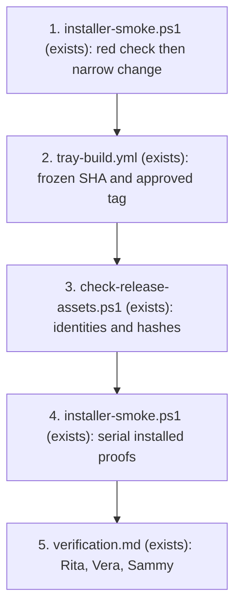

# Windows rc3 installer closeout

**Approved**: 2026-11-06 - user: "mas no caso o otto nao precisa comunicar aqui, apenas receber a info e eu fico acompanhado pelo chat privado com ele. Acima disso pode seguir e avancar para finalizar a implementacao"
Approval source: Engineering message ad171789-64a9-4e9f-8aa8-1f9166ce14bd. Existing PR route approved; exact-SHA tag authorization remains pending.

Status: proposed, awaiting Sammy's approval. Profile: standard, inherited from the installer.
Repository: sammyjdev/voxis. Existing PR: https://github.com/sammyjdev/voxis/pull/4.
Baseline: `55260fe4d019ae53e7d7895417539d9e0f124322`, branch `spike/windows-rust-stt`, base `master`.
This is an additive closeout of `.specs/features/windows-installer`, not a replacement feature plan.

## Problem

The installer verification says PASS round 7, but its installer rows carry rc2 evidence reported at
`cf30309`; the rc2 tag itself points at `6a1c022`. Neither identifies an installer built from the current
head. PR review findings F8 and F10 remain open: final-head smoke evidence is missing and the reverse
edition switch has not been proven. The owner cannot yet accept the rc3 installer on that evidence.

Completion gives the owner a traceable pair of rc3 installers and independent evidence for both
edition switches. It does not establish readiness to merge the Rust port.

## Preserved decisions

- Original AC 1-18 and checks C1-C29 remain binding, with their recorded amendments. Use RC criteria
  below only for closeout; do not renumber, weaken or rewrite the approved criteria.
- Keep NSIS current-user installation, `dev.sammyj.voxis`, both editions, existing sidecar/resource
  layout, model pins and locations, explicit configuration overrides, and uninstall model retention.
- CUDA 13.3.1 is effective via door 12 and resolved question 3. Retain the original 13.5 entries as
  decision history. Door 11 supersedes the plugin decision in door 6. Do not reopen either decision.
- Menu click wiring remains owner-accepted without automated proof, including its known surviving
  wiring fault. This closeout adds no click-handler obligation.
- Review F1-F7/F9 are resolved. F11-F15 are nonblocking nits, not an automatic fix list. F14 affects
  evidence trust: witness the real transcription exit separately, without changing original C15 or
  silently adding the F14 script fix. F13 is handled through backup/recovery, not a broad refactor.
- The previous security pass was same-vendor/degraded. Do not relabel it independent GLM review.

## Shape

Reuse `tray-build.yml`, both installer scripts and the approved installer obligations. Changes in
the smoke's reverse-switch decision are tested in isolation before changing that decision; installed
artifact proofs remain at the installation/runtime boundary, independently run by Rita.

1. `installer-smoke.ps1` (exists) - Dani adds only missing replacement assertions, following a red
   check, while preserving the existing flags and CUDA-to-Vulkan path.
2. `tray-build.yml` (exists) - an owner-authorized rc3 tag at a frozen SHA builds both Windows editions;
   `windows-release` attaches their NSIS installers to a draft release.
3. `check-release-assets.ps1` (exists) - confirms the two exact names; additional metadata and hashes
   bind downloaded bytes to the tag, run, attempt and frozen SHA.
4. `installer-smoke.ps1` (exists) - runs serially on those downloaded bytes; independent installed
   binary witnesses supplement its missing exit and reverse-runtime assertions.
5. `verification.md` (exists, installer feature) - Rita appends an rc3 report and full coverage
   accounting; older evidence remains explicitly historical. Vera assesses acceptance through
   coordination, then Sammy gives final acceptance.



Data: none - no application schema, model pins, secrets or configuration migration is introduced.
Evidence files record ReleaseCandidate, Artifact and SmokeRun identities, not application entities.

**Changes underneath**

| Front | What changes |
| --- | --- |
| domain | No product meaning changes; replacement proof covers both values of the existing edition |
| stored data | No migration; backup existing user data before smokes and restore after every path |
| readers | Rita, Vera and Sammy consume final-SHA evidence; historical PASS is not final-head proof |
| smoke | Reverse replacement must check same folder, both CUDA DLLs and installed runtime, beyond one registry entry |
| workflow | Reuse existing PR #4, pending approval of that exception; no second PR or ready transition |

## Flow

Execute only after approval, in this order:

- Dani records Sammy's exact approval in this plan, derives the final checks from this draft and
  validates them. Start in an isolated checkout; do not reset or clean the owner's checkout.
- Establish green baseline using the original Windows gate. Add one failing reverse-switch proof
  before changing smoke behavior. Fix the smallest failing assertion path; keep changes limited to
  smoke evidence and its checks/docs. A product defect outside that boundary returns to Sammy.
- Rita independently reviews the narrow change before release. Author development runs do not
  count as independent verification. Findings return through Felix only after Sammy's `@Felix sim`.
- Freeze candidate `R`: the exact PR head descended from baseline after approved smoke/check changes
  and review fixes, with green original gates. Record its full 40-character SHA and diff. Baseline
  `55260fe` is not predeclared the release SHA because a smoke change is expected. No unresolved
  finding or product decision can be hidden in R. Ask Sammy to authorize tagging that exact R.
- Recheck remote PR head, absence of `v0.2.0-rc3` and absence of its release. If either exists, stop
  and report its SHA/assets; never move the tag or overwrite assets silently. With Sammy's exact-SHA
  authorization, Dani creates and pushes `v0.2.0-rc3` at R. Do not manually dispatch a second build.
- Observe the tag-triggered `tray-build` run: both `windows` matrix jobs and `windows-release` must
  succeed. Capture run URL, ID, attempt and head SHA. The pre-existing macOS signing failure is
  recorded separately: `windows-release` depends only on `windows`. The historical uncached CUDA
  build took 68 minutes; that is an estimate, not a deadline or promise. Use OpenBot event waiting
  for a long job; do not schedule an alternative build.
- Confirm draft status and the two exact asset names, then download those release assets into a new
  evidence directory containing no other installers. Record asset IDs, sizes, timestamps and SHA-256
  locally; compare the release digest when supplied. Extract a reference manifest for each installer
  without executing its app, and retain installed executable/DLL hashes for edition identity.
- Complete the recovery preflight below. Rita runs the exact matrix in checks.md on those artifacts,
  serially and from a non-elevated shell, retaining each command, stdout, stderr and exit code.
- Rita reruns the original Windows gates and accounts for all original C1-C29 at R, replacing the
  installer evidence for C1/C5/C6/C15-C18 with rc3 runs. Carry other evidence only with explicit
  unchanged-source justification. Append rc3 verification, run the skill proof/verification gates,
  and report F8/F10 closure separately from remaining port scope and degraded security history.
- Evidence-only commits after R must be identified as such: prove their diff contains no executable,
  packaging, dependency, workflow or smoke changes. Otherwise invalidate this candidate and return
  for a new candidate/tag decision; never claim final-head proof by carrying rc3 across such changes.
- Coordination sends the approved artifact/evidence to Vera by DM; Vera is not an Engineering member.
  Do not add members silently. Send the plan, review, blockers and decisions to Otto as focal point.
  Sammy alone accepts the installer. Keep PR #4 draft, with no merge or release publication.

## Recovery preflight

Before the first installer, inventory existing VOXIS installations, executable paths, processes,
HKCU uninstall and Run values, Start menu shortcut and installed version. Record hashes and make a
verified backup of the existing install, model files, `tray.json`, `peers.json` and frontend folder.
Keep secrets out of logs and shared evidence. Have the original installer or another verified restore
method available. If restoration cannot be demonstrated, stop before replacing any installation.

Use unique backup names and refuse existing `.smoke` paths. Do not let `Move-Item -Force` overwrite
user backups. If `smoke-marker.bin` already exists, back it up before the uninstall proof. Close only
the test-owned processes after arranging with the owner to pause their running tray. Record their
PIDs and wait for exit before restoring renamed paths. Do not terminate unrelated meetrec processes.

Run overlay with the checkout frontend absent and development tray configuration removed from
discovery. Back up both before invoking the script, because its moves precede its inner `try` and
its `Fail` uses `exit`. Maintain an external recovery journal before each move. On exception,
timeout or interruption, stop test-owned processes, wait for handle release, restore frontend and
config byte-for-byte, and verify hashes. After a hard interruption, perform this journal recovery
before another smoke. Restore the previous install, registry, shortcuts and process state at the end;
do not erase downloaded models or evidence. Report restoration failure as BLOCKED.

## Impact

Expected repo changes: `scripts/windows/installer-smoke.ps1`, a focused
`scripts/windows/installer-smoke-test.ps1` regression proof (new, execution phase), test evidence/check artifacts,
and installer verification documents. No application behavior or packaging redesign is planned.
Registry, installation and temporary renames are execution-stage effects requiring the approved
recovery preflight. Planning runs none of those actions.

## Surface

None - no new or changed external signature. Existing `-Edition`, `-Check`, `-InstallerDir` and
`-Keep` flags remain. Installer release names and draft visibility remain the approved contract.

## Landing

| One-way door | Literal shape | Alternative rejected |
| --- | --- | --- |
| rc3 artifact identity | `v0.2.0-rc3` pins R; draft assets `VOXIS_0.2.0-rc3_x64_cuda-setup.exe` and `VOXIS_0.2.0-rc3_x64_vulkan-setup.exe`, each with retained SHA-256 and run identity | Moving a tag or replacing bytes after proof invalidates artifact identity |

All original 12 doors remain as recorded, including supersession history. No new dependency or
storage shape is introduced. Nothing else in this closeout is hard to reverse.

## Criteria

### S1: traceable rc3 artifacts and installed evidence (P1)

**Acceptance Criteria**

1. WHEN rc3 is built THEN the evidence SHALL name 1 full release SHA R matching the tag, run head and candidate manifest, and exactly 2 edition installers with their asset IDs and SHA-256 values (RC1; original AC 14/C18, F8).
2. WHEN each rc3 installer runs non-elevated THEN it SHALL exit `0`, place `VOXIS.exe` and `meetrec.exe` together under `%LOCALAPPDATA%`, and provide the `VOXIS` Start menu shortcut (RC2; original AC 1/C1).
3. WHEN the installed CUDA tray runs without development config and checkout frontend THEN `GET /overlay` SHALL return `200` with the installed page's `<title>` (RC3; original AC 2/4, C4/C5).
4. WHEN installed CUDA `meetrec.exe devices --json` runs with `PATH=C:\Windows\System32;C:\Windows` THEN it SHALL exit `0` (RC4; original AC 5/C6).
5. WHEN installed Vulkan transcribes the smoke's pt-BR fixture THEN its folder SHALL contain 0 `cublas*.dll` files and its fresh `transcript.md` SHALL contain `transcrição`; the separate installed-process witness records exit `0` (RC5; original AC 12/C15, evidence safeguard for F14).
6. WHEN CUDA is replaced by Vulkan THEN the installation SHALL retain the same folder, exactly 1 HKCU `VOXIS` uninstall entry, 0 `cublas*.dll` files and an installed Vulkan transcription satisfying RC5 (RC6; original AC 13/C16, F10).
7. WHEN Vulkan is replaced by CUDA THEN the installation SHALL retain the same folder, exactly 1 HKCU `VOXIS` uninstall entry, both `cublas64_13.dll` and `cublasLt64_13.dll`, and installed CUDA execution satisfying RC4 (RC7; original AC 13, additive reverse-switch proof for F10).
8. WHEN either edition is uninstalled THEN the model files under `%LOCALAPPDATA%\voxis\models` SHALL keep identical SHA-256 values and the VOXIS uninstall entry count SHALL become `0` (RC8; original C17 and Observable uninstall).
9. IF a replacement fixture lacks either CUDA DLL or the installed CUDA command exits nonzero THEN the replacement proof SHALL fail with exit `1` before any behavior change is accepted (RC9; closes the proof gap rather than weakening original criteria).
10. WHEN closeout is reported THEN independent verification SHALL account for all 29 original checks plus RC1-RC9 at R, include command outputs and exit codes, restore backed-up user files byte-for-byte, and leave PR #4 draft with `0` merges (RC10).

## Gate

Original commands, executed later from the repo root in the required Windows toolchain environment:

```text
cmd /c scripts\windows\meetrec-test.cmd
cargo test --release --manifest-path apps\tray\src-tauri\Cargo.toml
powershell -File scripts\windows\check-readme.ps1
```

CI installer command remains `./scripts/windows/build-installer.ps1` with edition, version and
`CudaArchs='75;86;89;120'` supplied by the existing workflow. No repo code, tests or builds were run
by the planner. Reported 25 meetrec/61 Windows tray passes are review evidence, not planner results.

## Out of scope

| Excluded | Why |
| --- | --- |
| Full Rust port acceptance or PR merge readiness | PR explicitly describes the remainder as unreviewed spike code, not meant to merge as-is |
| Marking ready, merging, publishing release, new PR | Installer evidence closeout does not authorize those transitions |
| F11-F15 fixes, including F14 script rewrite | Nits are not accepted implementation scope; direct exit evidence addresses false positives |
| macOS signing repair, ARM64, Windows 10 | Existing exclusions and pre-existing failure remain |
| Model/config migration, new dependencies, design changes | Preserve the approved installer decisions |

## Assumptions

| Assumption | Chosen default | Rationale | Confirmed? |
| --- | --- | --- | --- |
| Access to VOXIS and coverage | Authorized and coverage updated | Sammy: "eu autorizo os 2 tanto voce agir nesse repo como incluir ele nos repos cobertoss"; message e3a3610f-c8d4-4888-aa23-22affb84a12e | y |
| Branch route | Continue PR #4 on `spike/windows-rust-stt`, without a new PR | Prevent duplicate spike scope; approval of this plan must include this exception to `dev/<slug>` | n |
| Release authorization | Ask for the exact R before pushing rc3 | R is unknown until narrow checks/change/review land; repo access approval is not a release approval | n |
| Test machine | Existing Windows 11 x64 GPU machine, non-elevated shell, pinned models available | Matches the original installer test boundary; execution preflight must confirm | n |

**Open questions:**

- blocks execution: Does Sammy approve continuing the existing draft PR #4 rather than creating
  `dev/windows-rc3-closeout` and another PR? Recommendation: approve the existing-PR exception with
  this plan; it preserves spike history and avoids presenting the whole port as a new feature.
- blocks release: Exact R and authorization to push `v0.2.0-rc3` are deferred to the execution-stage
  freeze report. Recommendation: authorize only the recorded reviewed SHA, after checks pass.

## Differences from the source

None - original obligations and accepted decisions remain. RC criteria add missing evidence and
safety controls. They do not replace C16 or turn F14 into an unapproved product fix.

## Sources

- `.specs/features/windows-installer/{plan.md,checks.md,verification.md}` at baseline - binding;
  original criteria, supersession history and round-7 evidence limits.
- `scripts/windows/{installer-smoke.ps1,check-release-assets.ps1,build-installer.ps1,meetrec-test.cmd}`
  and `.github/workflows/tray-build.yml` at baseline - binding implementation and command contracts.
- https://github.com/sammyjdev/voxis/pull/4 - binding PR scope and owner-deferred F8/F10.
- https://github.com/sammyjdev/voxis/pull/4#pullrequestreview-5809159612 - binding round-2 resolution;
  reviewed SHA `fb4d3480d71457a87da20728e4c66ac1c9015834`, no new blocker.
- https://github.com/sammyjdev/voxis/actions/runs/42323778709 - observed success for python and tray at
  baseline. GitHub tag lookup returned no rc3 tag and release lookup returned `release not found`.
- Parker's closeout handoff and Engineering channel instructions - binding owners and stops.

Read-only inspection also confirmed the only post-review diff is deletion of two comment lines.
The owner's checkout marks `apps/tray/src-tauri/Cargo.toml` modified with no textual numstat diff;
preserve it. A fresh read-only planning clone is at
`C:\Users\samde\OpenBot\Shared\voxis-rc3-planning-b8c4fb69`.
